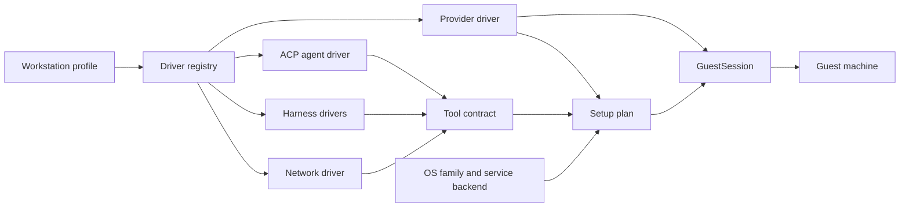

# open-agent Architecture

**How the pieces fit, where state lives, and how to change them safely.**

_A maintainer's map of the CLI on your computer, the drivers it selects, and the setup it drives on the guest._

> 🧭 **Start here, then go deeper.** This guide explains the current structure in plain terms. The accepted decisions behind it live in [docs/architecture/decisions](docs/architecture/decisions/), and the detailed runtime reference is [docs/architecture/workstation.md](docs/architecture/workstation.md). When this guide and the code disagree, the code wins; fix the guide.

 

•&emsp;🧠 [Mental Model](#-mental-model)&emsp;•&emsp;📂 [Directory Map](#-directory-map)&emsp;•&emsp;🔄 [Lifecycle](#-lifecycle)&emsp;•&emsp;🧩 [Adding a Driver](#-adding-a-driver)&emsp;•&emsp;🧪 [Testing](#-testing)&emsp;•

 

---

## 🧠 Mental Model

Every workstation is described by one **profile**, and everything else follows from it:

1. **Profile** (`src/domain/profile.ts`): the `WorkstationProfile` names one `provider`, one `agent`, at least one harness in `harnesses`, one `network`, and the `options` (exit node, proxy, idle and hold minutes, the update due interval, minimum CPUs and memory, and the agent's release channel). `validateProfile` checks a candidate against the drivers' declared capabilities, so an impossible combination fails before any provider call.
2. **Driver registry** (`src/composition/registry.ts`): a typed registry of every driver, keyed by kind (`providers`, `harnesses`, `agents`, `networks`, `gateways`) and id. The flag choices, such as `--provider sprite, fly-machine`, come from it and the closed id tuples (`src/domain/ids.ts`), and `defaults.selection` (`src/composition/defaults.ts`) picks `sprite`, `t3`, `claude` + `codex` and `none` when nothing else chooses.
3. **Drivers** (`src/adapters/drivers/<kind>/<id>/`): each implements its kind's contract in `src/application/ports/drivers.ts`:
   - a **provider** creates, lists, resizes, exposes and deletes machines and opens the guest channel (`sprite`, `fly-machine`);
   - an **ACP agent** installs and serves the public agent and mints pairing codes (`t3`);
   - a **harness** installs a coding CLI and merges its native settings, hooks, proxy routing and plugins (`claude`, `codex`);
   - a **network** enrolls the guest in a private network and cleans it up (`none`, `tailscale`).
4. **Host-driven setup** ([ADR-16](docs/architecture/decisions/workstation/adr-16-host-driven-guest-setup.md)): the host sets a guest up by sending checked commands over the provider's guest channel. It is built from three layers:
   - the **provider** (`src/adapters/drivers/providers/`): provisioning, the guest channel, its OS `images`, its `serviceBackend`, `openRootShell`, `awaitGuestReady` and an optional boot hook;
   - the **OS family** (`src/adapters/guest/os/`, `guest/os/`): `debian/lib.sh` (packages, repositories, accounts, replay), and beside it the service backends (`src/adapters/guest/services/`: `runit`, `cron`, `provider`);
   - the **tool contract** (`src/domain/tools.ts`, `src/adapters/guest/tools/`): one `ToolSpec` per tool, with its `brew`, `system`, `npm` or `rustup` sources in preference order.

   The guest keeps only small POSIX `sh` programs for self-maintenance (the top-level `guest/` tree).

A provider differs from another only by the data in its `ProviderCapabilities` (`src/domain/declarations.ts`): how the application reaches the guest (`guestChannel`), who decides when it sleeps (`keepAwakeMode`), whether a resize restarts it, and so on. Its `images` and `serviceBackend` are declared beside them on the driver. Application code branches on those, never on a provider's name. [ADR-9](docs/architecture/decisions/workstation/adr-9-typed-driver-catalog.md) records why.

---

## 📂 Directory Map

The source is six layers. Dependencies point one way: a layer imports the layers above it in this table, and itself.

| #   | Layer             | Directory                                       | Holds                                                                                                                                                                                                | May import                                                                   |
| --- | ----------------- | ----------------------------------------------- | ---------------------------------------------------------------------------------------------------------------------------------------------------------------------------------------------------- | ---------------------------------------------------------------------------- |
| 0   | kernel            | `src/kernel/`                                   | Leaf helpers with no product knowledge: faults, redaction, secrets, guards, records, operation context, navigation exits, the version and the status sink                                            | Node built-ins and npm packages only                                         |
| 1   | domain            | `src/domain/`                                   | The closed id unions, declaration and capability data, the profile and its rules, tool specs, machine sizes, prerequisites and the data shapes of observations                                       | kernel                                                                       |
| 2a  | application ports | `src/application/ports/`                        | The contracts adapters implement: drivers, guest channel, session, plan, OS family, guest mechanics, host, interaction and `ApplicationDependencies`                                                 | kernel, domain                                                               |
| 2b  | application       | `src/application/` (everything except `ports/`) | Workflows (`create`, `setup`, `inspect`, `terminate`, input resolution), policy, install and inspection progress messages, failure translation and the catalog lookups over the injected registry    | kernel, domain, application                                                  |
| 3   | adapters          | `src/adapters/{host,guest,drivers}/`            | Real IO: the host process and filesystem, the guest platform, OS families, services, tools, plan and inspection, and one folder per driver                                                           | kernel, domain, application ports, adapters (within the declared sub-matrix) |
| 4   | composition       | `src/composition/`                              | The concrete registry (`registry.ts`), the defaults (`defaults.ts`) and `createDependencies()`                                                                                                       | everything except `src/cli`                                                  |
| 5   | CLI               | `src/cli/` (with `components/` and `output/`)   | Stricli commands, flags, argument rewriting, execution and cancellation, the Ink views and prompts, the output projection, serialization and exit codes; components render and never call a provider | everything except `src/adapters`                                             |

Adapters import application **ports**, never application policy. A driver's guest `sh` programs live under `guest/drivers/<kind>/<id>/`, beside the other top-level folders:

| Path                 | What lives there                                                                                                                                                                                     |
| -------------------- | ---------------------------------------------------------------------------------------------------------------------------------------------------------------------------------------------------- |
| `bin/cli.mjs`        | The installed executable; runs the compiled entry `lib/cli/index.js`, reports an unhandled failure generically, then sets the exit status and exits                                                  |
| `guest/`             | Every guest `sh` program, at the path it installs to under `/opt/open-agent` and shipped as it is: `governor/`, `maintenance/`, `services/`, `accounts/`, `os/`, `tools/` and `drivers/<kind>/<id>/` |
| `spec/`              | Unit specs mirroring `src/`, plus `fixtures/`, `mocks/` and `lint/` (the layer-boundary spec)                                                                                                        |
| `e2e/`               | End-to-end specs (`*.spec.e2e.ts`) that drive the packed CLI, `setup.ts` (build, pack, install, sweeps) and `machines/`, the helpers the machine specs share                                         |
| `docs/architecture/` | The runtime reference ([workstation.md](docs/architecture/workstation.md)) and the ADRs                                                                                                              |

Two rules keep the folders honest ([ADR-9](docs/architecture/decisions/workstation/adr-9-typed-driver-catalog.md), [ADR-17](docs/architecture/decisions/workstation/adr-17-layer-map-and-output-projection.md), [ADR-16](docs/architecture/decisions/workstation/adr-16-host-driven-guest-setup.md)):

- **Driver isolation**: a concrete driver name appears only in its own folder, `src/domain/ids.ts` and `src/composition/registry.ts` (with its defaults). Drivers import application ports, never application policy or composition.
- **Guest boundary**: a guest program is a `.sh` file under `guest/` that the host reads as an asset (`guestAsset` in `src/adapters/guest/platform/assets.ts`) and sends to the guest; no host module runs one. Guest paths, such as the guest root and the agent's home, are defined once in `src/adapters/guest/platform/layout.ts`, and `readAsset` hands them to every program as `OA_*` variables after its shebang, so no program spells a path itself.

Reviewers check the layer matrix and the driver and guest rules by repository search; no lint rule enforces them.

---

## 💻 Your Computer and the Guest

| Runs on your computer                                                               | Runs on the guest                                                                                          |
| ----------------------------------------------------------------------------------- | ---------------------------------------------------------------------------------------------------------- |
| The `open-agent` CLI, its Ink prompts and its output                                | Small `sh` programs: launchers, the idle governor, the awake adapter, the update gate and the updater      |
| Input resolution, credential sources and the saved provider token                   | The tools Homebrew, apt, npm and rustup installed, and the agent service (`t3-code`)                       |
| Provider management: the Sprites SDK, or the Fly Machines API and `fly ssh console` | `tailscaled` when selected, `cron` as `open-agent-cron`, and on a Fly Machine `runit` and the boot hook    |
| The `GuestSession` and the setup plan, which drive every guest change               | `/opt/open-agent/environment.json` and `update-status.json`, the records the guest programs read and write |
| Tailscale management: device lookup, key minting, deletion                          | The init stub (`init.sh`) on a Fly Machine, and on a Sprite the provider's own services                    |
| Preflight, readiness assessment and the decision to expose the agent                |                                                                                                            |
| End-to-end run cleanup and the `oa-e2e-*` sweep                                     |                                                                                                            |

Inputs resolve in one order: flags, then credential references (`env:`, `file:`, `keychain:`), then the `--credential-file` dotenv file, which stays on the caller, then the process environment, then the saved profile, prompts and defaults. The provider, the selected network, the CLIProxyAPI gateway (base URL and API key), the GitHub token and the Git identity each declare the inputs they need, and a command checks the ones it uses, setup included, before it changes anything. Every absent input is reported at once with its fix, in one wording: "Set X or pass --credential-file FILE containing X; use --flag; or run in a TTY to enter it when prompted."

Management credentials (`SPRITES_TOKEN`, `FLY_API_TOKEN`, `TAILSCALE_API_KEY`) never leave your computer. A Tailscale enrollment key reaches the guest only as a step input, and never touches a disk. GitHub and CLIProxyAPI client credentials are the exception: they are stored on purpose in protected native configuration on the guest.

Every guest command goes through the provider's **guest channel** (`src/application/ports/guest-channel.ts`): the Sprites SDK's exec on a Sprite, and `fly ssh console` with a token derived in memory on a Fly Machine. Setup runs in a **`GuestSession`** (`src/adapters/guest/platform/session/`): a root shell the provider opens with `openRootShell` once `awaitGuestReady` returns. The host sends it one framed command at a time, as the account the step names, and reads the exit code from a marker line. The session holds the setup lock and an awake hold while it lives. Only a broken shell or framing is retried; a command's own failure is a result. There is no open-agent code or Node on the guest to set up first.

The **setup plan** (`src/adapters/guest/plan/`) is a list of typed `SetupStep`s ordered by `needs`, each with a check, an apply, a verify, a timeout and a retry class. A step whose check passes is skipped, so a rerun repairs only what is missing. A `Secret` is accepted only as step input. The plan comes from the provider's boot-hook step, the OS family's libraries, the resolved tools and the service backend's services. The `agent` account is 2000:2000, clear of the 1000 an image's first user takes, and the `linuxbrew` account is 900:900, a system id the bootstrap packages leave free; the Fly boot hook recreates both under the ids their homes on the volume carry. Setup streams each step as a status line on stderr when nothing interactive is displayed, and takes about 32 to 40 minutes on Fly and about 7 minutes on a Sprite. Tailscale enrolment hands the key to `tailscale up` on descriptor 3 (`--auth-key=file:/dev/fd/3`), and Tailscale needs `iproute2` for its `ip` calls.

---

---

## 🔄 Lifecycle

### Create

`createWorkstation` in `src/application/create.ts` runs four traced stages:

1. **Preflight** (`create.preflight`, `src/application/create/preflight.ts`): resolve inputs, validate the profile, check the declared prerequisites of the provider, network and gateway and the network's facts, resolve every tool against the provider's declared image, and report every fixable problem in one `INPUT` error before anything is provisioned. A required tool with no usable source is refused here.
2. **Provision** (`create.provider`): the provider creates a private machine sized by `pickMachine` (`src/domain/machine-sizes.ts`), the smallest offer meeting the minimums.
3. **Configure** (`src/application/create/configure.ts`): open a `GuestSession`, check the guest's OS family against the provider's declaration, then run the plan: guest libraries, boot hook, accounts, packages, Homebrew, one step per tool, the governor's directories and `environment.json` (state `incomplete`), network enrolment, native harness and account configuration, then the agent and maintenance services. A managed `create` hold (`src/application/create/hold.ts`) keeps the machine awake throughout.
4. **Finish** (`src/application/create/finish.ts`): wait until the agent serves, expose it publicly, mark `environment.json` ready and set the provider's `ready` label, and only then mint a pairing code when `--with-pair-code` asked for one.

A failure after provisioning keeps the machine, marks it incomplete and reports its identity so `setup --section all` can recover it.

### Setup

`setup` finds the workstation, checks the management labels, refuses one a newer open-agent set up, reads the recorded profile from `/opt/open-agent/environment.json` (`src/application/setup/recorded.ts`) and runs only the selected sections in `src/application/setup/sections.ts`, each as plan steps in a session. The provider and agent are fixed; `--section all` may change harnesses, network, release channel and options. `--cpu`/`--mem` resize through `src/application/setup/resize.ts`, which asks first when the provider declares `resizeRestarts`. A targeted section never marks the workstation ready; only a full setup does. `--section env` writes the `--env-file` variables to the agent's `runtime-env.json`, which the agent launcher reads, and to `~/.config/open-agent/env.sh` of the agent and each provider shell account, which their `.zshenv`, `.profile` and `.bashrc` read (`src/adapters/guest/native/shell-env.ts`). `--section system` runs the `--setup-file` executable once as root from a private file in `/tmp`, removed however it ends (`src/adapters/guest/platform/setup-file.ts`); create runs it after the native configuration, before the services start. Without its file, each section asks for a path in a terminal, and without a terminal it skips the section, reports it as `skipped` and exits 0.

### Downgrade refusal

Setup writes the open-agent version into `environment.json` and into the provider's metadata. Every command that acts on an existing workstation refuses one recorded with a newer version (`src/adapters/guest/release-guard.ts`, a `CONFLICT`). `list` is not an action, so it lists such a workstation and marks it (`newerRelease` in `--json`) instead of refusing; ordinary `show` compares the metadata version without waking the guest; `show --inspect`, `doctor` and `setup` read `environment.json`; `terminate` wakes the guest to read it and falls back to the metadata only when the guest cannot be read. An absent `environment.json` is not newer.

### Update

Maintenance installs in place and never touches a service ([ADR-12](docs/architecture/decisions/workstation/adr-12-in-place-maintenance.md), whose no-restart rule ADR-16 keeps):

1. Every hour, cron (`/etc/cron.d/open-agent`, run by `open-agent-cron`) starts `update-gate.sh`, which lets the updater through once the due interval in `environment.json` (default 1 day) has passed since the last success. There is no check interval.
2. The gate takes the setup session's lock without waiting, so an update and a setup session never overlap: while a session holds the lock, a due update waits for the next hour and the gate notes that in `update.log`. Otherwise it takes a managed awake hold and runs `updater.sh`. `setup --section tools --update` runs the gate with `--force` from its session, which already holds the lock.
3. The updater upgrades each tool `environment.json` records through its manager: `apt-get install --only-upgrade` for system packages, `brew upgrade` for Homebrew formulae that have a bottle, after refreshing only the formula data, since Homebrew's own code stays at the release setup pins, npm by dist-tag and `rustup update`. It never installs a missing tool.
4. The success time advances only when every required tool succeeded, and the outcome goes to `update-status.json`. A new agent or daemon version runs the next time its service restarts.

### Idle

One idle governor (`guest/governor/awake.sh`) decides when the workstation may sleep ([ADR-13](docs/architecture/decisions/workstation/adr-13-idle-governor.md), now in `sh`). Harness hooks run `/opt/open-agent/guest/awake.sh`: a prompt opens a turn hold, each tool call is a heartbeat, the end of a turn closes it. Managed work, including a setup session, opens managed holds. The deadline is the later of the last heartbeat plus `idleTimeoutMinutes` and the latest open hold, and no hold outlives `holdMaxMinutes`. The provider's awake adapter applies it:

- **Sprite** (`native-deadline`): `guest/drivers/providers/sprite/awake.sh`, run as the agent account, mirrors the deadline into a Sprite task, so the idle and hold limits are capped at 60 minutes.
- **Fly Machine** (`governed`): cron runs the governor's `tick` as root every minute; once the deadline passes, `guest/drivers/providers/fly-machine/awake.sh` suspends the machine through the `/.fly/api` socket, or stops it when a suspend is ruled out or refused.

### Cold boot (Fly Machine)

A Fly Machine is created from `debian:bookworm-slim` with `persist_rootfs: "always"`, so its root filesystem survives a restart and a normal cold boot installs nothing ([ADR-16](docs/architecture/decisions/workstation/adr-16-host-driven-guest-setup.md)). The machine configuration holds only the machine's init, `/usr/local/sbin/open-agent-boot` (`guest/drivers/providers/fly-machine/init.sh`), which runs the boot hook on the volume, `boot.sh`, so setup can update the hook without a restart. On every boot the hook:

1. checks the `/data` volume and binds `/data/open-agent`, `/data/home/agent`, `/data/home/linuxbrew` and `/data/apt` over `/opt/open-agent`, `/home/agent`, `/home/linuxbrew` and apt's lists;
2. recreates the `agent` and `linuxbrew` accounts under their original ids;
3. when the marker `/var/lib/open-agent/rootfs-restored` is missing, which means the root filesystem was wiped, reinstalls the recorded apt packages from the cache in `/data/apt`;
4. restores the Homebrew links `environment.json` records into `/usr/local/bin` where missing, writes `/etc/profile.d/open-agent.sh`, labels the machine and sets `net.ipv4.ping_group_range`;
5. writes `/run/open-agent/boot-ready`, logs to `/opt/open-agent/boot.log` and `boot-status.json`, and replaces itself with `runsvdir`, which runs the services under `/etc/service`.

Tailscale's node state is in `/opt/open-agent/state/tailscale`, on the volume, so the enrollment survives. The host opens the guest channel only after the boot-ready file names the current boot.

---

## 🧩 Adding a Driver

Use an existing driver of the same kind as your template: `src/adapters/drivers/networks/none/` is the smallest, `src/adapters/drivers/networks/tailscale/` shows a network with guest code.

1. **Create the entry and folder**: `src/adapters/drivers/<kind>/<id>.ts` exports a driver typed by its kind's contract, and `src/adapters/drivers/<kind>/<id>/` holds its modules, such as `NetworkDriver<'<id>'>` or `ProviderDriver<'<id>'>` from `src/application/ports/drivers.ts`. Keep every reference to the driver's name inside these two.
2. **Declare capabilities as data.** A provider fills `ProviderCapabilities`, its `machines` offers and its `prerequisites` (host tools and the credential's environment name, as in `src/adapters/drivers/providers/sprite/prerequisites.ts`). It also declares its OS `images` (family, release, architectures), its `serviceBackend`, `openRootShell`, `awaitGuestReady` and, if the machine resets something on boot, a `bootHookStep`. If the application would need an `if (provider === …)`, add a capability instead and record it in an ADR.
3. **Add tools and guest programs, if any.** A harness, agent or network describes what it installs as `ToolSpec`s (`src/domain/tools.ts`) with `sources` in preference order, so it reuses an OS family and needs no installer. A launcher, hook or adapter is a POSIX `sh` file at `guest/drivers/<kind>/<id>/`, declared with `guestAsset(path, mode)` (`src/adapters/guest/platform/assets.ts`), where `path` is relative to `guest/`. It reads JSON with `jq`, uses the `OA_*` variables for every guest path, is installed root-owned and is exercised by the machine specs.
4. **Register the driver**: add its id to the tuple in `src/domain/ids.ts`, then import it in `src/composition/registry.ts`, give it a typed constant, and add it to its kind's record. The `satisfies` check fails to compile until the registry holds the ids. Flag choices and help text then pick it up.
5. **Wire inputs** a new option needs into `src/domain/selection-inputs.ts` and `src/application/input/`; credentials use the `env:`, `file:` and `keychain:` source references.
6. **Test it**: unit specs in `spec/adapters/drivers/<kind>/<id>/` mirroring the source, and, for a provider, an end-to-end spec in `e2e/` that runs the shared machine suite; run it before you call the driver done.
7. **Add an OS family or service backend instead, if that is what is new.** A family adds its `family.ts` under `src/adapters/guest/os/<family>/`, its `lib.sh` and updater fragment under `guest/os/<family>/`, and a `system` source on each tool Homebrew cannot provide there. A backend adds its service and job installer under `src/adapters/guest/services/`.
8. **Document it**: the README's support matrix, prerequisites and environment table, `.env.example`, and `.env.test.example` for any credential the end-to-end suite needs.

---

## 🗄️ Guest State

| Path                                             | Contents                                                                                                                                                       |
| ------------------------------------------------ | -------------------------------------------------------------------------------------------------------------------------------------------------------------- |
| `/opt/open-agent`                                | The guest root: the `sh` programs setup installed, mirroring the package's `guest/` tree, all root-owned                                                       |
| `/opt/open-agent/environment.json`               | The one record setup leaves: version, setup state, OS family, resolved tools, update schedule, governor and launch facts                                       |
| `/opt/open-agent/update-status.json`             | The updater's last run: each tool's outcome and versions, and the last success (`update.log` beside it is its log)                                             |
| `/run/open-agent-session/session.lock`           | The setup session's lock, root-only, which the hourly update gate also takes                                                                                   |
| `/opt/open-agent/run/awake`, `run/awake-root`    | The agent's holds (sticky, root:agent 1770) and root's managed holds (root:agent 2750), each with its account's record of the governor state (`governor.json`) |
| `/opt/open-agent/state/tailscale`                | Tailscale's node identity and resolver files, root-only                                                                                                        |
| `/home/linuxbrew/.linuxbrew`                     | Homebrew, owned by the `linuxbrew` account; bottles only                                                                                                       |
| `/usr/local/bin`                                 | Links to Homebrew tools' executables the system lacks, made by `links.sh` and restored at boot when missing                                                    |
| `/etc/sv`, `/etc/service`, `/var/log/open-agent` | runit service directories, their enabling links and logs (Fly Machine)                                                                                         |
| `/etc/cron.d/open-agent`                         | The hourly `update-gate` job and, on a governed provider, the per-minute `governor-tick`                                                                       |
| `/opt/open-agent/boot.log`, `boot-status.json`   | Fly Machine only: each boot's steps and the last boot's result                                                                                                 |
| `/data`                                          | Fly Machine only: the volume holding `open-agent/`, `home/agent`, `home/linuxbrew` and the `apt/` cache                                                        |

Live facts, such as name, id, organization and URL, come from the provider; the setup state is a provider label or metadata entry (`open-agent-setup-ready` or `open-agent-setup-incomplete` on a Sprite). There is no local registry of workstations ([ADR-3](docs/architecture/decisions/workstation/adr-3-live-workstation-metadata.md)).

---

## 🧪 Testing

| Command                                              | Project           | What it proves                                                                                                                                                                                          |
| ---------------------------------------------------- | ----------------- | ------------------------------------------------------------------------------------------------------------------------------------------------------------------------------------------------------- |
| `pnpm test`                                          | `open-agent:UNIT` | Specs under `spec/` mirroring `src/`; only `@fly/sprites` and the Fly Machines API (through `fetch`) are replaced                                                                                       |
| `pnpm test:e2e [cli\|automation-progress]`           | `open-agent:E2E`  | The installed CLI, driven with no terminal and no credentials: parsing, output, exit codes and cancellation                                                                                             |
| `pnpm test:e2e sprite` / `pnpm test:e2e fly-machine` | `open-agent:E2E`  | One real machine type: the shared suite creates, configures, runs and terminates real workstations, plus each provider's own probe (the Sprite awake task; Fly's suspend, resume, cold boot and update) |

Unit specs never mock native file merging, parsers, processes or Ink; they use real temporary files. The guest `sh` programs have no unit specs: the machine specs run them on a real guest. Lint uses the shared preset defaults for `src` and `spec`, excluding `bin`, `e2e` and `guest`. The vitest projects come from Presetter's configuration unchanged, plus the committed `vitest.config.e2e.ts`; an argument to `pnpm test:e2e` picks a spec file by name.

`e2e/setup.ts` runs once per run: it loads `.env.test`, builds, packs and installs the package into a temporary run home exactly as a user installs it, and then sweeps. Every spec drives that installed CLI, never the checkout.

End-to-end machine runs spend real money and touch real accounts; run them only with the owner's approval.

- **Credentials**: they live in `.env.test`, which is gitignored; `.env.test.example` documents every `TEST_*` variable. Values already in the environment win over the file. The CLI receives each `TEST_X` as `X`, in a minimal environment of its own (`PATH`, an isolated `HOME` and the credentials), so specs pass no `--credential-file`. A machine spec without its provider token fails with the CLI's own preflight message.
- **Run prefix**: each run gets an id `oa-e2e-<8 hex digits>`, and every workstation it creates carries it. Each run keeps its flyctl configuration in its own directory under the run home, which is removed at the end.
- **Start sweep**: whenever any provider token is set, a run first removes every `oa-e2e-*` workstation and tailnet device its credentials reach, whichever run left it. Use an account whose `oa-e2e-*` workstations all belong to the suite.
- **Cleanup**: at the end of a run, or on an interrupt, cleanup is best effort. It sends every delete request once, then prints either `cleanup successful` or the workstations to check by hand. Rerunning `pnpm test:e2e cli` with the same credentials sweeps what remains.

---

## 🛠️ Maintenance Tasks and Pitfalls

### Common Tasks

- **Run the CLI from the checkout**: `pnpm run local -- <command> --help`. The `local` script builds, packs and installs the package into a temporary directory, runs the installed bin with your arguments and removes the directory. It always runs the packed package, so source and package aliases never mix.
- **Import with the aliases**: `#*` maps to `src/*.ts` and `#cli/components/*` to `src/cli/components/*.tsx` in the checkout; `publishConfig.imports` maps only `#*` to `lib/*.js` in the tarball, which covers the compiled components too. Specs import `spec/mocks` and `spec/fixtures` relatively. Relative and `#*` imports carry no extension; the build adds `.js`. The checkout's compiled bin cannot run, so tests exercise the packed publication (`e2e/setup.ts` builds, packs and installs it) and never rewrite aliases.
- **Change tooling configuration**: edit `presetter.config.ts`; `eslint.config.ts`, `vitest.config.ts` and the tsconfig files are generated from it.
- **Add a managed developer tool**: add a `ToolSpec` to the base set in `src/adapters/guest/tools/base.ts`, with a `brew` source first and a `system` source where Homebrew has no bottle. The boot hook needs no change because it restores the links `environment.json` records.
- **Change a guest program**: setup reads each `.sh` from the package's `guest/` directory, which ships as it is, and writes it to the guest, so the next `setup` from a rebuilt package deploys the change. A change to the Fly boot hook reaches a machine on its next `setup` and takes effect at the next boot; `init.sh` is written into the machine configuration at creation, so a change to it reaches only machines created afterwards.
- **Check before a pull request**: `pnpm typecheck`, `pnpm lint`, `pnpm build`, `pnpm test` and `pnpm test:e2e cli`.

### Pitfalls

- **Never build from source on a guest.** Tools come from Homebrew bottles, distro packages, npm or rustup; a tool without a bottle for the platform falls through to its next source, is skipped when optional, and is refused at preflight when required. It is never compiled. Do not add a build step or a compiler-driven fallback.
- **Do not add lint suppressions.** Fix the code instead. The single existing exception, a documented Fly routing fact in `src/adapters/drivers/providers/fly-machine/private-networks.ts`, is not a precedent.
- **Import source across folders with `#` subpaths, never `../`.** Same-folder `./` imports are fine; only spec helpers under `spec/mocks` and `spec/fixtures` are reached relatively. A folder's entry is the sibling file `<name>.ts`, not `<name>/index.ts`; `src/cli/index.ts`, the package entry, is the only index file.
- **Do not add boundary lint rules or extra aliases.** `presetter.config.ts` carries no `import/no-restricted-paths` zones, and `package.json` adds no aliases for spec helpers. Keep lint tests out of the repository.
- **open-agent is greenfield.** There is no compatibility code, migration or alias for agent-sprite workstations, labels, paths or credentials. Rename and remove cleanly instead of adding a shim.
- **Keep guest programs POSIX `sh`.** They run under `dash` on Debian and read JSON with `jq`. Do not use bashisms, and never spell a guest path in a program: use the `OA_*` variable `readAsset` assigns from `src/adapters/guest/platform/layout.ts`.
- **Keep the `--` in `bin/cli.mjs`.** Its shebang is `#!/usr/bin/env -S node --`. Node 24 scans the whole command line for its own `--env-file` option, even after the script name, and exits 9 when the path is missing, before the CLI runs. Never remove the `--`, and never launch the CLI as `node bin/cli.mjs …`; use `node -- bin/cli.mjs …`.
- **The updater never restarts services.** Do not add a stop, start or restart to the update path; release-channel changes restart the agent through `setup`.
- **Secrets stay in step input.** A `Secret` is piped on standard input or written to a 0600 file in a private directory under `/dev/shm` that a trap removes; a consumer that opens it once should remove it first and read the open descriptor, as Tailscale's enrollment does. Never put one in argv or on a disk path.
- **Declare the inputs an adapter needs.** A credential or option a provider, network, gateway or setup section requires is declared and checked in preflight with `missingInput` (`src/domain/prerequisites.ts`), so the command fails before it changes anything and says what to set. Never report a bare `Missing: X`.
- **Do not downgrade.** A command must pass the release guard before it acts on an existing workstation; a new command that does not use it can overwrite a newer workstation's state.
- **Root never runs code the agent account can write.** Every program under `/opt/open-agent` is root-owned, 0700 or 0755 (0755 only when another account runs it); keep it that way when adding programs. The locked `linuxbrew` account is written only by root acting as it, so root may run Homebrew's executables, but every root `PATH` lists `/usr/sbin:/usr/bin:/sbin:/bin` before `/usr/local`, and root reads JSON with `/usr/bin/jq`, which is 1.6 on Debian 12, so keep root's jq programs to what 1.6 accepts (no keyword as a variable name, no `if` without `else`, no later builtin).

---

## 📚 Further Reading

- [Workstation architecture](docs/architecture/workstation.md): the detailed runtime reference
- [Architecture index](docs/architecture/README.md): every ADR with its status
- [ADR-9](docs/architecture/decisions/workstation/adr-9-typed-driver-catalog.md) driver catalog, [ADR-12](docs/architecture/decisions/workstation/adr-12-in-place-maintenance.md) maintenance, [ADR-13](docs/architecture/decisions/workstation/adr-13-idle-governor.md) idle governor, [ADR-14](docs/architecture/decisions/workstation/adr-14-fly-persistence-and-supervisor.md) Fly persistence, [ADR-16](docs/architecture/decisions/workstation/adr-16-host-driven-guest-setup.md) host-driven guest setup, [ADR-17](docs/architecture/decisions/workstation/adr-17-layer-map-and-output-projection.md) layer map and output projection
- [README](README.md): installation, usage and the CLI reference
