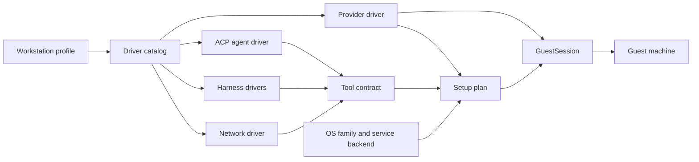

# open-agent Architecture

**How the pieces fit, where state lives, and how to change them safely.**

_A maintainer's map of the CLI on your computer, the drivers it selects, and the setup it drives on the guest._

> 🧭 **Start here, then go deeper.** This guide explains the current structure in plain terms. The accepted decisions behind it live in [docs/architecture/decisions](docs/architecture/decisions/), and the detailed runtime reference is [docs/architecture/workstation.md](docs/architecture/workstation.md). When this guide and the code disagree, the code wins; fix the guide.

 

•&emsp;🧠 [Mental Model](#-mental-model)&emsp;•&emsp;📂 [Directory Map](#-directory-map)&emsp;•&emsp;🔄 [Lifecycle](#-lifecycle)&emsp;•&emsp;🧩 [Adding a Driver](#-adding-a-driver)&emsp;•&emsp;🧪 [Testing](#-testing)&emsp;•

 

---

## 🧠 Mental Model

Every workstation is described by one **profile**, and everything else follows from it:

1. **Profile** (`src/core/profile.ts`): the `WorkstationProfile` names one `provider`, one `agent`, at least one harness in `harnesses`, one `network`, and the `options` (exit node, proxy, idle and hold minutes, the update due interval, minimum CPUs and memory, and the agent's release channel). `validateProfile` checks a candidate against the drivers' declared capabilities, so an impossible combination fails before any provider call.
2. **Driver catalog** (`src/core/catalog.ts`): a typed registry of every driver, keyed by kind (`providers`, `harnesses`, `agents`, `networks`) and id. The flag choices, such as `--provider sprite, fly-machine`, come from it (`src/core/ids.ts`), and `DEFAULT_SELECTION` picks `sprite`, `t3`, `claude` + `codex` and `none` when nothing else chooses.
3. **Drivers** (`src/drivers/<kind>/<id>/`): each implements its kind's contract in `src/drivers/contracts.ts`:
   - a **provider** creates, lists, resizes, exposes and deletes machines and opens the guest channel (`sprite`, `fly-machine`);
   - an **ACP agent** installs and serves the public agent and mints pairing codes (`t3`);
   - a **harness** installs a coding CLI and merges its native settings, hooks, proxy routing and plugins (`claude`, `codex`);
   - a **network** enrolls the guest in a private network and cleans it up (`none`, `tailscale`).
4. **Host-driven setup** ([ADR-15](docs/architecture/decisions/workstation/adr-15-host-driven-guest-setup.md)): the host sets a guest up by sending checked commands over the provider's guest channel. It is built from three layers:
   - the **provider** (`src/drivers/providers/`): provisioning, the guest channel, its OS `images`, its `serviceBackend`, `openRootShell`, `awaitGuestReady` and an optional boot hook;
   - the **OS family** (`src/os/`): `debian/lib.sh` (packages, repositories, accounts, replay) and the service backends (`runit`, `cron`, `provider`);
   - the **tool contract** (`src/tools/`): one `ToolSpec` per tool, with its `brew`, `system`, `npm` or `rustup` sources in preference order.

   The guest keeps only small POSIX `sh` programs for self-maintenance (`src/guest/`, the OS and tool layers, and the drivers' own `guest/` folders).

A provider differs from another only by the data in its `ProviderCapabilities` (`src/drivers/contracts.ts`): how core reaches the guest (`guestChannel`), who decides when it sleeps (`keepAwakeMode`), whether a resize restarts it, and so on. Its `images` and `serviceBackend` are declared beside them on the driver. Core code branches on those, never on a provider's name. [ADR-9](docs/architecture/decisions/workstation/adr-9-typed-driver-catalog.md) records why.

---

## 📂 Directory Map

| Path                             | What lives there                                                                                                                                                                                         |
| -------------------------------- | -------------------------------------------------------------------------------------------------------------------------------------------------------------------------------------------------------- |
| `bin/cli.mjs`                    | The installed executable; runs the compiled entry `lib/cli/index.js`, reports an unhandled failure generically, then sets the exit status and exits                                                      |
| `src/cli/`                       | Stricli commands (`commands.ts`), flags (`flags.ts`), argument rewriting (`parser.ts`), execution and cancellation (`execute.ts`), output, JSON serialization and the Ink interaction bridge             |
| `src/components/`                | Every React/Ink view and prompt; components render and collect input but never call a provider                                                                                                           |
| `src/core/`                      | The driver catalog, ids, the profile and its rules, selection inputs (`selection-inputs.ts`), provider binding and lookup, preflight and derived service names                                           |
| `src/drivers/<kind>/<id>/`       | One folder per driver: its `index.ts`, host code and, when it runs anything on the guest, `guest/`                                                                                                       |
| `src/drivers/<kind>/<id>/guest/` | The driver's guest `sh` programs: launchers, awake adapters and, on Fly Machines, the boot stub and boot hook                                                                                            |
| `src/drivers/shared/`            | Profile-level options several drivers use, such as `cliproxyapi/` (the proxy hub client and its guest probe) and shared prerequisite checks                                                              |
| `src/guest/`                     | Guest `sh` programs every provider shares: `awake.sh` (idle governor), `update-gate.sh` and `updater.sh`, plus `assets.ts` (how a program is read from the package) and `guest-root.ts`                  |
| `src/os/`                        | OS families and service backends: `debian/` (`lib.sh`, `update-system.sh`) and `services/` (`runit/`, `cron`, `provider`)                                                                                |
| `src/tools/`                     | The tool contract: `ToolSpec`, the base tool set, the source resolver, Homebrew's account and `links.sh`, and the `homebrew`, `npm` and `rustup` helper libraries                                        |
| `src/input/`                     | Input resolution: credential sources, dotenv, process environment, saved profile, prompts and driver selection (`selection*.ts`)                                                                         |
| `src/create/`                    | The create workflow's steps: preflight, configuration, the create hold, readiness, exposure, pairing and failure recovery                                                                                |
| `src/setup/`                     | The setup workflow's sections (`sections.ts`, `all.ts`, `network.ts`, `plugins.ts`, `resize.ts`) and incomplete-setup recovery                                                                           |
| `src/integrations/`              | Narrow boundaries to the outside: local credentials and the clipboard, the guest (`guest/`: session, setup plan, `environment.json`, updates, inspection) and native Claude/Codex/GitHub/Git (`native/`) |
| `src/workstation/`               | Shared configuration order, provider location and the action menu                                                                                                                                        |
| `src/*.ts`                       | Root workflows and contracts: `workstation.ts` (dispatch), `create.ts`, `setup.ts`, `inspect.ts`, `terminate.ts`, `operation.ts`, `errors.ts`, `validation.ts`, `readiness.ts`                           |
| `scripts/`                       | `packed-cli.ts`, which builds, packs and installs the package to run it (`pnpm run local`, `pnpm test:e2e`, `pnpm test:live`); `source-hooks.ts` and `process-group.ts` support it                       |
| `spec/`                          | Unit specs mirroring `src/`, `spec/e2e/` for the packed CLI and guest programs, `spec/live/` for real providers, plus `fixtures/` and `mocks/`                                                           |
| `docs/architecture/`             | The runtime reference ([workstation.md](docs/architecture/workstation.md)) and the ADRs                                                                                                                  |

Two rules keep the folders honest ([ADR-9](docs/architecture/decisions/workstation/adr-9-typed-driver-catalog.md), [ADR-11](docs/architecture/decisions/workstation/adr-11-workflow-and-selection-layout.md), [ADR-15](docs/architecture/decisions/workstation/adr-15-host-driven-guest-setup.md)):

- **Driver isolation**: a concrete driver name appears only in its own folder and `src/core/catalog.ts`. Drivers make only type imports from core.
- **Guest boundary**: a guest program is a `.sh` file the host reads as an asset (`guestAsset` in `src/guest/assets.ts`) and sends to the guest; no host module runs one. A few constants, such as the guest root and the Fly boot paths, appear in both and are kept in step by review.

No lint rule enforces these; reviewers check them by repository search.

---

## 💻 Your Computer and the Guest

| Runs on your computer                                                               | Runs on the guest                                                                                          |
| ----------------------------------------------------------------------------------- | ---------------------------------------------------------------------------------------------------------- |
| The `open-agent` CLI, its Ink prompts and its output                                | Small `sh` programs: launchers, the idle governor, the awake adapter, the update gate and the updater      |
| Input resolution, credential sources and the saved provider token                   | The tools Homebrew, apt, npm and rustup installed, and the agent service (`t3-code`)                       |
| Provider management: the Sprites SDK, or the Fly Machines API and `fly ssh console` | `tailscaled` when selected, `cron` as `open-agent-cron`, and on a Fly Machine `runit` and the boot hook    |
| The `GuestSession` and the setup plan, which drive every guest change               | `/opt/open-agent/environment.json` and `update-status.json`, the records the guest programs read and write |
| Tailscale management: device lookup, key minting, deletion                          | The provider's boot stub on a Fly Machine, and on a Sprite the provider's own services                     |
| Preflight, readiness assessment and the decision to expose the agent                |                                                                                                            |
| Live run cleanup and the `oa-live-*` sweep                                          |                                                                                                            |

Management credentials (`SPRITES_TOKEN`, `FLY_API_TOKEN`, `TAILSCALE_API_KEY`) never leave your computer. A Tailscale enrollment key reaches the guest only as a step input, and never touches a disk. GitHub and CLIProxyAPI client credentials are the exception: they are stored on purpose in protected native configuration on the guest.

Every guest command goes through the provider's **guest channel** (`src/drivers/guest-channel.ts`): the Sprites SDK's exec on a Sprite, and `fly ssh console` with a token derived in memory on a Fly Machine. Setup runs in a **`GuestSession`** (`src/integrations/guest/session/`): a root shell the provider opens with `openRootShell` once `awaitGuestReady` returns. The host sends it one framed command at a time, as the account the step names, and reads the exit code from a marker line. The session holds the setup lock and an awake hold while it lives. Only a broken shell or framing is retried; a command's own failure is a result. There is no open-agent code or Node on the guest to set up first.

The **setup plan** (`src/integrations/guest/plan/`) is a list of typed `SetupStep`s ordered by `needs`, each with a check, an apply, a verify, a timeout and a retry class. A step whose check passes is skipped, so a rerun repairs only what is missing. A `Secret` is accepted only as step input. The plan comes from the provider's boot-hook step, the OS family's libraries, the resolved tools and the service backend's services. The `agent` account is 2000:2000, clear of the 1000 an image's first user takes, and the `linuxbrew` account is 900:900, a system id the bootstrap packages leave free; the Fly boot hook recreates both under the ids their homes on the volume carry. Setup streams each step as a status line on stderr when nothing interactive is displayed, and takes about 32 to 40 minutes on Fly and about 7 minutes on a Sprite. Tailscale enrolment hands the key to `tailscale up` on descriptor 3 (`--auth-key=file:/dev/fd/3`), and Tailscale needs `iproute2` for its `ip` calls.

---

---

## 🔄 Lifecycle

### Create

`createWorkstation` in `src/create.ts` runs four traced stages:

1. **Preflight** (`create.preflight`, `src/create/preflight.ts`): resolve inputs, validate the profile, check provider prerequisites and network facts, resolve every tool against the provider's declared image, and report every fixable problem in one `INPUT` error before anything is provisioned. A required tool with no usable source is refused here.
2. **Provision** (`create.provider`): the provider creates a private machine sized by `pickMachine` (`src/drivers/machine-sizes.ts`), the smallest offer meeting the minimums.
3. **Configure** (`src/create/configure.ts`): open a `GuestSession`, check the guest's OS family against the provider's declaration, then run the plan: guest libraries, boot hook, accounts, packages, Homebrew, one step per tool, the governor's directories and `environment.json` (state `incomplete`), network enrolment, native harness and account configuration, then the agent and maintenance services. A managed `create` hold (`src/create/hold.ts`) keeps the machine awake throughout.
4. **Finish** (`src/create/finish.ts`): wait until the agent serves, expose it publicly, mark `environment.json` ready and set the provider's `ready` label, and only then mint a pairing code when `--with-pair-code` asked for one.

A failure after provisioning keeps the machine, marks it incomplete and reports its identity so `setup --section all` can recover it.

### Setup

`setup` finds the workstation, checks the management labels, refuses one a newer open-agent set up, reads the recorded profile from `/opt/open-agent/environment.json` (`src/setup/recorded.ts`) and runs only the selected sections in `src/setup/sections.ts`, each as plan steps in a session. The provider and agent are fixed; `--section all` may change harnesses, network, release channel and options. `--cpu`/`--mem` resize through `src/setup/resize.ts`, which asks first when the provider declares `resizeRestarts`. A targeted section never marks the workstation ready; only a full setup does.

### Downgrade refusal

Setup writes the open-agent version into `environment.json` and into the provider's metadata. Every command that acts on an existing workstation refuses one recorded with a newer version (`src/integrations/guest/release-guard.ts`, a `CONFLICT`). `list` is not an action, so it lists such a workstation and marks it (`newerRelease` in `--json`) instead of refusing; ordinary `show` compares the metadata version without waking the guest; `show --inspect`, `doctor` and `setup` read `environment.json`; `terminate` wakes the guest to read it and falls back to the metadata only when the guest cannot be read. An absent `environment.json` is not newer.

### Update

Maintenance installs in place and never touches a service ([ADR-12](docs/architecture/decisions/workstation/adr-12-in-place-maintenance.md), whose no-restart rule ADR-15 keeps):

1. Every hour, cron (`/etc/cron.d/open-agent`, run by `open-agent-cron`) starts `update-gate.sh`, which lets the updater through once the due interval in `environment.json` (default 1 day) has passed since the last success. There is no check interval.
2. The gate takes the setup session's lock without waiting, so an update and a setup session never overlap: while a session holds the lock, a due update waits for the next hour and the gate notes that in `update.log`. Otherwise it takes a managed awake hold and runs `updater.sh`. `setup --section tools --update` runs the gate with `--force` from its session, which already holds the lock.
3. The updater upgrades each tool `environment.json` records through its manager: `apt-get install --only-upgrade` for system packages, `brew upgrade` for Homebrew formulae that have a bottle, after refreshing only the formula data, since Homebrew's own code stays at the release setup pins, npm by dist-tag and `rustup update`. It never installs a missing tool.
4. The success time advances only when every required tool succeeded, and the outcome goes to `update-status.json`. A new agent or daemon version runs the next time its service restarts.

### Idle

One idle governor (`src/guest/awake.sh`) decides when the workstation may sleep ([ADR-13](docs/architecture/decisions/workstation/adr-13-idle-governor.md), now in `sh`). Harness hooks run `/opt/open-agent/guest/awake.sh`: a prompt opens a turn hold, each tool call is a heartbeat, the end of a turn closes it. Managed work, including a setup session, opens managed holds. The deadline is the later of the last heartbeat plus `idleTimeoutMinutes` and the latest open hold, and no hold outlives `holdMaxMinutes`. The provider's awake adapter applies it:

- **Sprite** (`native-deadline`): `sprite-awake.sh`, run as the agent account, mirrors the deadline into a Sprite task, so the idle and hold limits are capped at 60 minutes.
- **Fly Machine** (`governed`): cron runs the governor's `tick` as root every minute; once the deadline passes, `fly-machine-awake.sh` suspends the machine through the `/.fly/api` socket, or stops it when a suspend is ruled out or refused.

### Cold boot (Fly Machine)

A Fly Machine is created from `debian:bookworm-slim` with `persist_rootfs: "always"`, so its root filesystem survives a restart and a normal cold boot installs nothing ([ADR-15](docs/architecture/decisions/workstation/adr-15-host-driven-guest-setup.md)). The machine configuration holds only a stub, `/usr/local/sbin/open-agent-boot` (`src/drivers/providers/fly-machine/guest/boot-stub.sh`), which runs the boot hook on the volume, `boot.sh`, so setup can update the hook without a restart. On every boot the hook:

1. checks the `/data` volume and binds `/data/open-agent`, `/data/home/agent`, `/data/home/linuxbrew` and `/data/apt` over `/opt/open-agent`, `/home/agent`, `/home/linuxbrew` and apt's lists;
2. recreates the `agent` and `linuxbrew` accounts under their original ids;
3. when the marker `/var/lib/open-agent/rootfs-restored` is missing, which means the root filesystem was wiped, reinstalls the recorded apt packages from the cache in `/data/apt`;
4. restores the Homebrew links `environment.json` records into `/usr/local/bin` where missing, writes `/etc/profile.d/open-agent.sh`, labels the machine and sets `net.ipv4.ping_group_range`;
5. writes `/run/open-agent/boot-ready`, logs to `/opt/open-agent/boot.log` and `boot-status.json`, and replaces itself with `runsvdir`, which runs the services under `/etc/service`.

Tailscale's node state is in `/opt/open-agent/state/tailscale`, on the volume, so the enrollment survives. The host opens the guest channel only after the boot-ready file names the current boot.

---

## 🧩 Adding a Driver

Use an existing driver of the same kind as your template: `src/drivers/networks/none/` is the smallest, `src/drivers/networks/tailscale/` shows a network with guest code.

1. **Create the folder** `src/drivers/<kind>/<id>/` with an `index.ts` that exports a driver typed by its kind's contract, such as `NetworkDriver<'<id>'>` or `ProviderDriver<'<id>'>` from `src/drivers/contracts.ts`. Keep every reference to the driver's name inside this folder.
2. **Declare capabilities as data.** A provider fills `ProviderCapabilities`, its `machines` offers and its `prerequisites` (host tools and the credential's environment name, as in `src/drivers/providers/sprite/prerequisites.ts`). It also declares its OS `images` (family, release, architectures), its `serviceBackend`, `openRootShell`, `awaitGuestReady` and, if the machine resets something on boot, a `bootHook`. If core would need an `if (provider === …)`, add a capability instead and record it in an ADR.
3. **Add tools and guest programs, if any.** A harness, agent or network describes what it installs as `ToolSpec`s (`src/tools/contracts.ts`) with `sources` in preference order, so it reuses an OS family and needs no installer. A launcher, hook or adapter is a POSIX `sh` file under the driver's `guest/` folder, declared with `guestAsset(path, mode)` (`src/guest/assets.ts`). It reads JSON with `jq`, passes `shellcheck` in `lint:check` with no suppression and is installed root-owned.
4. **Register the driver** in `src/core/catalog.ts`: import it, give it a typed constant, and add it to its kind's record. The `satisfies` checks fail to compile until the catalog holds the ids. Flag choices and help text then pick it up.
5. **Wire inputs** a new option needs into `src/core/selection-inputs.ts` and `src/input/`; credentials use the `env:`, `file:` and `keychain:` source references.
6. **Test it**: unit specs in `spec/drivers/<kind>/<id>/` mirroring the source, the packed guest-program checks in `spec/e2e/guest-assets.spec.e2e.ts` and `guest-programs.spec.e2e.ts`, and a live run before you call it done.
7. **Add an OS family or service backend instead, if that is what is new.** A family adds its `lib.sh` and updater fragment under `src/os/<family>/` and a `system` source on each tool Homebrew cannot provide there. A backend adds its service and job installer under `src/os/services/`.
8. **Document it**: the README's support matrix, prerequisites and environment table, and `.env.example`.

---

## 🗄️ Guest State

| Path                                             | Contents                                                                                                                                                       |
| ------------------------------------------------ | -------------------------------------------------------------------------------------------------------------------------------------------------------------- |
| `/opt/open-agent`                                | The guest root: the `sh` programs setup installed (`guest/`, `os/`, `tools/`, `drivers/`), all root-owned                                                      |
| `/opt/open-agent/environment.json`               | The one record setup leaves: version, setup state, OS family, resolved tools, update schedule, governor and launch facts                                       |
| `/opt/open-agent/update-status.json`             | The updater's last run: each tool's outcome and versions, and the last success (`update.log` beside it is its log)                                             |
| `/run/open-agent-session/session.lock`           | The setup session's lock, root-only, which the hourly update gate also takes                                                                                   |
| `/opt/open-agent/run/awake`, `run/awake-root`    | The agent's holds (sticky, root:agent 1770) and root's managed holds (root:agent 2750), each with its account's record of the governor state (`governor.json`) |
| `/opt/open-agent/state/tailscale`                | Tailscale's node identity and resolver files, root-only                                                                                                        |
| `/home/linuxbrew/.linuxbrew`                     | Homebrew, owned by the `linuxbrew` account; bottles only                                                                                                       |
| `/usr/local/bin`                                 | Links to Homebrew tools' executables the system lacks, made by `links.sh` and restored at boot when missing                                                    |
| `/etc/sv`, `/etc/service`, `/var/log/open-agent` | runit service directories, their enabling links and logs (Fly Machine)                                                                                         |
| `/etc/cron.d/open-agent`                         | The hourly `update-gate` job and, on a governed provider, the per-minute `governor-tick`                                                                       |
| `/opt/open-agent/boot.log`, `boot-status.json`   | Fly Machine only: each boot's steps and the last boot's result                                                                                                 |
| `/data`                                          | Fly Machine only: the volume holding `open-agent/`, `home/agent`, `home/linuxbrew` and the `apt/` cache                                                        |

Live facts, such as name, id, organization and URL, come from the provider; the setup state is a provider label or metadata entry (`open-agent-setup-ready` or `open-agent-setup-incomplete` on a Sprite). There is no local registry of workstations ([ADR-3](docs/architecture/decisions/workstation/adr-3-live-workstation-metadata.md)).

---

## 🧪 Testing

| Command              | Project               | What it proves                                                                                                     |
| -------------------- | --------------------- | ------------------------------------------------------------------------------------------------------------------ |
| `pnpm test`          | `open-agent:UNIT`     | Specs under `spec/` mirroring `src/`; only `@fly/sprites` and the Fly Machines API (through `fetch`) are replaced  |
| `pnpm test:e2e`      | `open-agent:E2E`      | Builds, packs and installs the package, then drives the installed CLI in a real PTY and runs the guest programs    |
| `pnpm test:live`     | `open-agent:LIVE`     | Creates, configures and terminates real workstations on the provider `OPEN_AGENT_LIVE_PROVIDER` (default `sprite`) |
| `pnpm test:live:fly` | `open-agent:LIVE-FLY` | The Fly Machine probe: creates, serves, suspends, resumes, cold-boots, updates and deletes real machines           |

Unit specs never mock native file merging, parsers, processes or Ink; they use real temporary files. The guest `sh` programs have no unit specs: `lint:check` runs `sh -n` and `shellcheck`, `spec/e2e` checks that the packed programs match the source and exercises them, and live runs prove the rest. The vitest projects are generated by Presetter from `presetter.config.ts`.

Live runs spend real money and touch real accounts; run them only with the owner's approval. They read `.env`, or the file `OPEN_AGENT_LIVE_ENV` names, and refuse to start without the needed credential (`FLY_API_TOKEN` for the Fly probe). Cleanup rules:

- **Run prefix**: each run gets an id `oa-live-<8 hex digits>`, and every workstation it creates carries it. Cleanup only ever touches names inside that prefix.
- **Guaranteed removal**: each workstation is terminated through the CLI, deleted directly if that fails, and then proven absent from the provider and the tailnet (`spec/live/cleanup.ts`).
- **Sweep**: a run that does not finish cleanly is swept again automatically. If that sweep fails too, rerun it yourself with `OPEN_AGENT_LIVE_RUN_ID=oa-live-<id> OPEN_AGENT_LIVE_SWEEP=1 pnpm test:live` (or `test:live:fly`), and check the provider console before leaving.

---

## 🛠️ Maintenance Tasks and Pitfalls

### Common Tasks

- **Run the CLI from the checkout**: `pnpm run local -- <command> --help`. It always runs the packed, installed package, so source and package aliases never mix ([ADR-8](docs/architecture/decisions/workstation/adr-8-source-and-packed-import-aliases.md)).
- **Change tooling configuration**: edit `presetter.config.ts`; `eslint.config.ts`, `vitest.config.ts` and the tsconfig files are generated from it.
- **Add a managed developer tool**: add a `ToolSpec` to the base set in `src/tools/base.ts`, with a `brew` source first and a `system` source where Homebrew has no bottle. The boot hook needs no change because it restores the links `environment.json` records.
- **Change a guest program**: setup reads each `.sh` from the installed package and writes it to the guest, so the next `setup` from a rebuilt package deploys the change. A change to the Fly boot hook reaches a machine on its next `setup` and takes effect at the next boot; the boot stub is written into the machine configuration at creation, so a change to it reaches only machines created afterwards.
- **Check before a pull request**: `pnpm typecheck`, `pnpm lint:check`, `pnpm build`, `pnpm test` and `pnpm test:e2e`.

### Pitfalls

- **Never build from source on a guest.** Tools come from Homebrew bottles, distro packages, npm or rustup; a tool without a bottle for the platform falls through to its next source, is skipped when optional, and is refused at preflight when required. It is never compiled. Do not add a build step or a compiler-driven fallback.
- **Do not add lint suppressions.** Fix the code instead. The single existing exception, a documented Fly routing fact in `src/drivers/providers/fly-machine/private-networks.ts`, is not a precedent.
- **open-agent is greenfield.** There is no compatibility code, migration or alias for agent-sprite workstations, labels, paths or credentials. Rename and remove cleanly instead of adding a shim.
- **Keep guest programs POSIX `sh`.** They run under `dash` on Debian, read JSON with `jq` and carry no `shellcheck` suppression. Do not use bashisms, and do not assume a program can import a constant from the host: repeat it and keep the copies in step.
- **Keep the `--` in `bin/cli.mjs`.** Its shebang is `#!/usr/bin/env -S node --`. Node 24 scans the whole command line for its own `--env-file` option, even after the script name, and exits 9 when the path is missing, before the CLI runs. Never remove the `--`, and never launch the CLI as `node bin/cli.mjs …`; use `node -- bin/cli.mjs …`.
- **The updater never restarts services.** Do not add a stop, start or restart to the update path; release-channel changes restart the agent through `setup`.
- **Secrets stay in step input.** A `Secret` is piped on standard input or written to a 0600 file in a private directory under `/dev/shm` that a trap removes; a consumer that opens it once should remove it first and read the open descriptor, as Tailscale's enrollment does. Never put one in argv or on a disk path.
- **Do not downgrade.** A command must pass the release guard before it acts on an existing workstation; a new command that does not use it can overwrite a newer workstation's state.
- **Root never runs code the agent account can write.** Every program under `/opt/open-agent` is root-owned, 0700 or 0755 (0755 only when another account runs it); keep it that way when adding programs. The locked `linuxbrew` account is written only by root acting as it, so root may run Homebrew's executables, but every root `PATH` lists `/usr/sbin:/usr/bin:/sbin:/bin` before `/usr/local`, and root reads JSON with `/usr/bin/jq`, which is 1.6 on Debian 12; a packaged e2e proof reads the shipped programs for what jq 1.6 rejects.

---

## 📚 Further Reading

- [Workstation architecture](docs/architecture/workstation.md): the detailed runtime reference
- [Architecture index](docs/architecture/README.md): every ADR with its status
- [ADR-9](docs/architecture/decisions/workstation/adr-9-typed-driver-catalog.md) driver catalog, [ADR-11](docs/architecture/decisions/workstation/adr-11-workflow-and-selection-layout.md) workflow homes, [ADR-12](docs/architecture/decisions/workstation/adr-12-in-place-maintenance.md) maintenance, [ADR-13](docs/architecture/decisions/workstation/adr-13-idle-governor.md) idle governor, [ADR-14](docs/architecture/decisions/workstation/adr-14-fly-persistence-and-supervisor.md) Fly persistence, [ADR-15](docs/architecture/decisions/workstation/adr-15-host-driven-guest-setup.md) host-driven guest setup
- [README](README.md): installation, usage and the CLI reference
