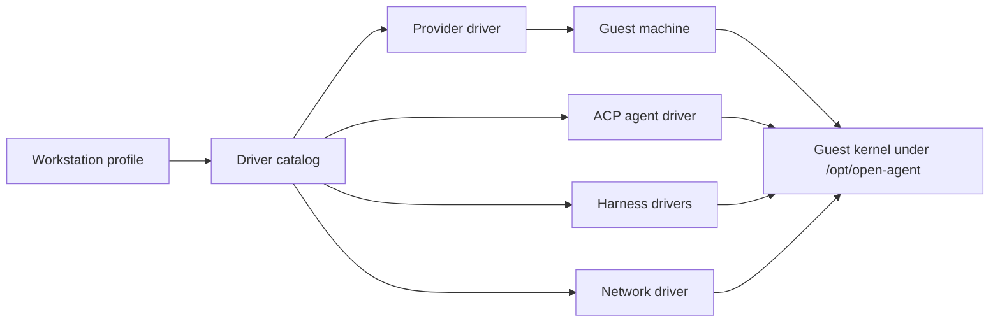

# open-agent Architecture

**How the pieces fit, where state lives, and how to change them safely.**

_A maintainer's map of the CLI on your computer, the drivers it selects, and the guest kernel it deploys._

> 🧭 **Start here, then go deeper.** This guide explains the current structure in plain terms. The accepted decisions behind it live in [docs/architecture/decisions](docs/architecture/decisions/), and the detailed runtime reference is [docs/architecture/workstation.md](docs/architecture/workstation.md). When this guide and the code disagree, the code wins; fix the guide.

 

•&emsp;🧠 [Mental Model](#-mental-model)&emsp;•&emsp;📂 [Directory Map](#-directory-map)&emsp;•&emsp;🔄 [Lifecycle](#-lifecycle)&emsp;•&emsp;🧩 [Adding a Driver](#-adding-a-driver)&emsp;•&emsp;🧪 [Testing](#-testing)&emsp;•

 

---

## 🧠 Mental Model

Every workstation is described by one **profile**, and everything else follows from it:

1. **Profile** (`src/core/profile.ts`): the `WorkstationProfile` names one `provider`, one `agent`, at least one harness in `harnesses`, one `network`, and the `options` (exit node, proxy, idle and hold minutes, update check and due intervals, minimum CPUs and memory, and the agent's release channel). `validateProfile` checks a candidate against the drivers' declared capabilities, so an impossible combination fails before any provider call.
2. **Driver catalog** (`src/core/catalog.ts`): a typed registry of every driver, keyed by kind (`providers`, `harnesses`, `agents`, `networks`) and id. The flag choices, such as `--provider sprite, fly-machine`, come from it (`src/core/ids.ts`), and `DEFAULT_SELECTION` picks `sprite`, `t3`, `claude` + `codex` and `none` when nothing else chooses.
3. **Drivers** (`src/drivers/<kind>/<id>/`): each implements its kind's contract in `src/drivers/contracts.ts`:
   - a **provider** creates, lists, resizes, exposes and deletes machines and opens the guest channel (`sprite`, `fly-machine`);
   - an **ACP agent** installs and serves the public agent and mints pairing codes (`t3`);
   - a **harness** installs a coding CLI and merges its native settings, hooks, proxy routing and plugins (`claude`, `codex`);
   - a **network** enrolls the guest in a private network and cleans it up (`none`, `tailscale`).
4. **Guest kernel** (`src/guest/`): the shared code that runs on the machine: the transaction worker, the tool installer, the updater, the idle governor and, on Fly Machines, the supervisor. Drivers contribute their own guest modules beside it.

A provider differs from another only by the data in its `ProviderCapabilities` (`src/drivers/contracts.ts`): how core reaches the guest (`guestChannel`), who runs services (`servicesMode`), who decides when it sleeps (`keepAwakeMode`), whether a resize restarts it, and so on. Core code branches on those capabilities, never on a provider's name. [ADR-9](docs/architecture/decisions/workstation/adr-9-typed-driver-catalog.md) records why.

---

## 📂 Directory Map

| Path                             | What lives there                                                                                                                                                                                     |
| -------------------------------- | ---------------------------------------------------------------------------------------------------------------------------------------------------------------------------------------------------- |
| `bin/cli.mjs`                    | The installed executable; loads the compiled CLI from `lib/` and is the last-resort output boundary                                                                                                  |
| `src/cli/`                       | Stricli commands (`commands.ts`), flags (`flags.ts`), argument rewriting (`parser.ts`), execution and cancellation (`execute.ts`), output, JSON serialization and the Ink interaction bridge         |
| `src/components/`                | Every React/Ink view and prompt; components render and collect input but never call a provider                                                                                                       |
| `src/core/`                      | The driver catalog, ids, the profile and its rules, selection inputs (`selection-inputs.ts`), guest-leaf registry, provider binding and lookup, preflight and derived service names                  |
| `src/drivers/<kind>/<id>/`       | One folder per driver: its `index.ts`, host code, and, when it deploys anything, `guest/`, `guest-modules.ts` and `guest-leaf.ts`                                                                    |
| `src/drivers/<kind>/<id>/guest/` | The driver's guest programs: launchers, installers, hooks, probes, awake adapters and the Fly boot script                                                                                            |
| `src/drivers/shared/`            | Profile-level options several drivers use, such as `cliproxyapi/` (the proxy hub client and its guest probe) and shared prerequisite checks                                                          |
| `src/guest/`                     | The guest kernel: `guest-transaction.ts`, `install-tools.ts`, `updater.ts`, `idle/`, `supervisor/`, `homebrew.ts`, `guest-root.ts`, and the two shell files `bootstrap-node.sh` and `update-gate.sh` |
| `src/input/`                     | Input resolution: credential sources, dotenv, process environment, saved profile, prompts and driver selection (`selection*.ts`)                                                                     |
| `src/create/`                    | The create workflow's steps: preflight, configuration, the create hold, readiness, exposure, pairing and failure recovery                                                                            |
| `src/setup/`                     | The setup workflow's sections (`sections.ts`, `all.ts`, `network.ts`, `plugins.ts`, `resize.ts`) and incomplete-setup recovery                                                                       |
| `src/integrations/`              | Narrow boundaries to the outside: local credentials and the clipboard, guest files, manifest, services and transactions (`guest/`), and native Claude/Codex/GitHub/Git configuration (`native/`)     |
| `src/workstation/`               | Shared configuration order, provider location and the action menu                                                                                                                                    |
| `src/*.ts`                       | Root workflows and contracts: `workstation.ts` (dispatch), `create.ts`, `setup.ts`, `inspect.ts`, `terminate.ts`, `operation.ts`, `errors.ts`, `validation.ts`, `readiness.ts`                       |
| `scripts/`                       | `packed-cli.ts`, which builds, packs and installs the package to run it (`pnpm run local`, `pnpm test:e2e`, `pnpm test:live`); `source-hooks.ts` and `process-group.ts` support it                   |
| `spec/`                          | Unit specs mirroring `src/`, `spec/e2e/` for the packed CLI and guest programs, `spec/live/` for real providers, plus `fixtures/` and `mocks/`                                                       |
| `docs/architecture/`             | The runtime reference ([workstation.md](docs/architecture/workstation.md)) and the ADRs                                                                                                              |

Two import rules keep the folders honest ([ADR-10](docs/architecture/decisions/workstation/adr-10-colocated-guest-code.md), [ADR-11](docs/architecture/decisions/workstation/adr-11-workflow-and-selection-layout.md)):

- **Driver isolation**: a concrete driver name appears only in its own folder, `src/core/catalog.ts` and `src/core/guest-leaves.ts`. Drivers make only type imports from core.
- **Guest boundary**: guest code imports only Node built-ins, `ws`, other guest code and the guest kernel. Host code never imports guest code at run time, except pure modules of constants, types and validators such as `src/guest/guest-root.ts`.

No lint rule enforces these; reviewers check them by repository search.

---

## 💻 Your Computer and the Guest

| Runs on your computer                                                               | Runs on the guest                                                                                        |
| ----------------------------------------------------------------------------------- | -------------------------------------------------------------------------------------------------------- |
| The `open-agent` CLI, its Ink prompts and its output                                | open-agent's private Node, `/opt/open-agent/node`, which is never on the agent's `PATH`                  |
| Input resolution, credential sources and the saved provider token                   | The transaction worker (`guest/guest-transaction.js`), which applies every configuration change          |
| Provider management: the Sprites SDK, or the Fly Machines API and `fly ssh console` | The tool installer and the scheduled updater                                                             |
| Tailscale management: device lookup, key minting, deletion                          | The agent service (`t3-code`), `tailscaled` when selected, and on a Sprite the `open-agent-cron` service |
| Preflight, readiness assessment and the decision to expose the agent                | The idle governor, the `open-agent-awake` hook command and the provider's awake adapter                  |
| Live run cleanup and the `oa-live-*` sweep                                          | On a Fly Machine, the boot script and the guest supervisor                                               |

Management credentials (`SPRITES_TOKEN`, `FLY_API_TOKEN`, `TAILSCALE_API_KEY`) never leave your computer. A Tailscale enrollment key reaches the guest only as a transient file removed after use. GitHub and CLIProxyAPI client credentials are the exception: they are stored on purpose in protected native configuration on the guest.

Every guest command goes through the provider's **guest channel** (`src/drivers/guest-channel.ts`): the Sprites SDK's exec on a Sprite, and `fly ssh console` with a token derived in memory on a Fly Machine. Configuration runs inside a **guest transaction** (`src/integrations/guest/transaction.ts`): inline shell takes the shared guest lock, bootstraps the private Node with `bootstrap-node.sh` when needed, and starts the compiled worker, which stages the remaining payloads and processes requests.

---

## 🔄 Lifecycle

### Create

`createWorkstation` in `src/create.ts` runs four traced stages:

1. **Preflight** (`create.preflight`, `src/create/preflight.ts`): resolve inputs, validate the profile, check provider prerequisites and network facts, and report every fixable problem in one `INPUT` error before anything is provisioned.
2. **Provision** (`create.provider`): the provider creates a private machine sized by `pickMachine` (`src/drivers/machine-sizes.ts`), the smallest offer meeting the minimums.
3. **Configure** (`src/create/configure.ts`): install managed tools, enroll the network, write native harness and account configuration, then register the agent and maintenance services. A managed `create` hold (`src/create/hold.ts`) keeps the machine awake throughout.
4. **Finish** (`src/create/finish.ts`): wait until the agent serves, expose it publicly, set the provider's `ready` label, and only then mint a pairing code when `--with-pair-code` asked for one.

A failure after provisioning keeps the machine, marks it incomplete and reports its identity so `setup --section all` can recover it.

### Setup

`setup` finds the workstation, checks the management labels, reads the recorded profile from `/opt/open-agent/manifest.json` (`src/setup/recorded.ts`) and runs only the selected sections in `src/setup/sections.ts`. The provider and agent are fixed; `--section all` may change harnesses, network, release channel and options. `--cpu`/`--mem` resize through `src/setup/resize.ts`, which asks first when the provider declares `resizeRestarts`. A targeted section never marks the workstation ready; only a full setup does.

### Update

Maintenance installs in place and never touches a service ([ADR-12](docs/architecture/decisions/workstation/adr-12-in-place-maintenance.md)):

1. Every minute, cron (`/etc/cron.d/open-agent` on a Sprite) or the supervisor's timer (on a Fly Machine) starts `update-gate.sh`, which lets a check through once `/opt/open-agent/update-check-minutes` minutes have passed.
2. `updater.js` runs only when the due interval has passed since the last success. It takes the shared lock and a managed awake hold, then runs the installer.
3. The installer's `ComponentLedger` (`src/guest/install-tools/ledger.ts`) resolves each component's latest stable version and skips every component already at it. Brew installs only bottles; Google Chrome is Google's stable `.deb`, checked against the SHA-256 in Google's apt index and unpacked unchanged under `/opt/open-agent/tools/google-chrome`, one directory per package that is never overwritten, so a running browser keeps the version it started from.
4. The success time advances only when every required component succeeded. A new agent or daemon version runs the next time its service restarts.

### Idle

One idle governor (`src/guest/idle/`) decides when the workstation may sleep ([ADR-13](docs/architecture/decisions/workstation/adr-13-idle-governor.md)). Harness hooks run `/opt/open-agent/bin/open-agent-awake`: a prompt opens a turn hold, each tool call is a heartbeat, the end of a turn closes it. Managed work opens managed holds. The deadline is the later of the last heartbeat plus `idleTimeoutMinutes` and the latest open hold, and no hold outlives `holdMaxMinutes`. The provider's awake adapter applies it:

- **Sprite** (`native-deadline`): `sprite-awake.js`, run as the agent account, mirrors the deadline into a Sprite task, so the idle and hold limits are capped at 60 minutes.
- **Fly Machine** (`governed`): the supervisor's tick runs `fly-machine-awake.js` as root once the deadline passes; it suspends the machine through the `/.fly/api` socket, or stops it when a suspend is ruled out or refused.

### Cold boot (Fly Machine)

A stopped Fly Machine loses its root filesystem ([ADR-14](docs/architecture/decisions/workstation/adr-14-fly-persistence-and-supervisor.md)). Its init is `/usr/local/sbin/open-agent-boot`, rendered by `src/drivers/providers/fly-machine/guest/boot-script.ts`, which on every boot:

1. checks the `/data` volume and binds `/data/open-agent`, `/data/home/agent` and `/data/home/linuxbrew` over `/opt/open-agent`, `/home/agent` and `/home/linuxbrew`;
2. recreates the `agent` and `linuxbrew` accounts under their original ids;
3. reinstalls the recorded apt packages from the cache in `/data/apt`;
4. replays the link record `/opt/open-agent/links` into `/usr/local/bin` and writes `/etc/profile.d/open-agent.sh`;
5. writes `/run/open-agent/boot-ready`, logs to `/opt/open-agent/boot.log` and `boot-status.json`, and hands over to the supervisor `/opt/open-agent/bin/open-agent-supervisor`.

The supervisor restores the services recorded in `/opt/open-agent/supervisor/services.json`. Tailscale's node state is in `/opt/open-agent/state/tailscale`, on the volume, so the enrollment survives. The host opens the guest channel only after the boot-ready file names the current boot.

---

## 🧩 Adding a Driver

Use an existing driver of the same kind as your template: `src/drivers/networks/none/` is the smallest, `src/drivers/networks/tailscale/` shows a network with guest code.

1. **Create the folder** `src/drivers/<kind>/<id>/` with an `index.ts` that exports a driver typed by its kind's contract, such as `NetworkDriver<'<id>'>` or `ProviderDriver<'<id>'>` from `src/drivers/contracts.ts`. Keep every reference to the driver's name inside this folder.
2. **Declare capabilities as data.** A provider fills `ProviderCapabilities`, its `machines` offers and its `prerequisites` (host tools and the credential's environment name, as in `src/drivers/providers/sprite/prerequisites.ts`). If core would need an `if (provider === …)`, add a capability instead and record it in an ADR.
3. **Add guest code, if any**, under `guest/`. Name each module with `driverModule('<kind>/<id>', '<file>.js')` in `guest-modules.ts`, and export the kind's guest leaf (`ProviderGuestLeaf`, `NetworkGuestLeaf` and so on) from a dependency-free `guest-leaf.ts`. Guest code obeys the guest import boundary.
4. **Register the guest leaf** in `GUEST_LEAVES` in `src/core/guest-leaves.ts`. Only a driver that deploys nothing, like the `none` network, has no leaf.
5. **Register the driver** in `src/core/catalog.ts`: import it, give it a typed constant, and add it to its kind's record. The `satisfies` checks fail to compile until the catalog and the leaf registry hold the same ids. Flag choices, help text and the payload inventory then pick it up.
6. **Wire inputs** a new option needs into `src/core/selection-inputs.ts` and `src/input/`; credentials use the `env:`, `file:` and `keychain:` source references.
7. **Test it**: unit specs in `spec/drivers/<kind>/<id>/` mirroring the source, the packed-payload checks in `spec/e2e/guest-payloads.spec.e2e.ts`, and a live run before you call it done.
8. **Document it**: the README's support matrix, prerequisites and environment table, and `.env.example`.

---

## 🗄️ Guest State

| Path                                                | Contents                                                                                                 |
| --------------------------------------------------- | -------------------------------------------------------------------------------------------------------- |
| `/opt/open-agent`                                   | The guest root: the deployed mirror of `lib/guest/` and `lib/drivers/<kind>/<id>/guest/`, all root-owned |
| `/opt/open-agent/node`                              | open-agent's private Node, installed by `bootstrap-node.sh` (component `guest-node`)                     |
| `/opt/open-agent/manifest.json`                     | The recorded profile, installed versions, enabled integrations, maintenance times and network identity   |
| `/opt/open-agent/install-outcomes.json`             | The ledger: each component's `installed`, `skipped` or `failed` outcome from the last install run        |
| `/opt/open-agent/install-tools.log`                 | The installer's private log                                                                              |
| `/opt/open-agent/links`                             | The link record: one `path<TAB>target` line per link the installer made in `/usr/local/bin`              |
| `/opt/open-agent/tools/google-chrome`               | Google Chrome, one unpacked stable package per release, linked as `/usr/local/bin/google-chrome`         |
| `/opt/open-agent/components.json`, `harnesses.json` | The data catalogs the host writes from the guest-leaf registry                                           |
| `/opt/open-agent/update-check-minutes`              | The update check interval the gate reads                                                                 |
| `/opt/open-agent/run/awake`, `run/awake-root`       | The idle governor's state (`governor.json`) and the agent and managed holds                              |
| `/opt/open-agent/state/tailscale`                   | Tailscale's node identity and resolver files, root-only                                                  |
| `/opt/open-agent/supervisor/`, `supervisor.log`     | Fly Machine only: the supervisor's recorded services and per-service logs, and its own log               |
| `/opt/open-agent/boot.log`, `boot-status.json`      | Fly Machine only: each boot's steps and the last boot's result                                           |
| `/data`                                             | Fly Machine only: the volume holding `open-agent/`, `home/agent`, `home/linuxbrew` and the `apt/` cache  |

Live facts, such as name, id, organization and URL, come from the provider; the setup state is a provider label or metadata entry (`open-agent-setup-ready` or `open-agent-setup-incomplete` on a Sprite). There is no local registry of workstations ([ADR-3](docs/architecture/decisions/workstation/adr-3-live-workstation-metadata.md)).

---

## 🧪 Testing

| Command              | Project               | What it proves                                                                                                     |
| -------------------- | --------------------- | ------------------------------------------------------------------------------------------------------------------ |
| `pnpm test`          | `open-agent:UNIT`     | Specs under `spec/` mirroring `src/`; only `@fly/sprites` and the Fly Machines API (through `fetch`) are replaced  |
| `pnpm test:e2e`      | `open-agent:E2E`      | Builds, packs and installs the package, then drives the installed CLI in a real PTY and runs the guest programs    |
| `pnpm test:live`     | `open-agent:LIVE`     | Creates, configures and terminates real workstations on the provider `OPEN_AGENT_LIVE_PROVIDER` (default `sprite`) |
| `pnpm test:live:fly` | `open-agent:LIVE-FLY` | The Fly Machine probe: creates, serves, suspends, resumes, cold-boots, updates and deletes real machines           |

Unit specs never mock native file merging, parsers, processes or Ink; they use real temporary files. The vitest projects are generated by Presetter from `presetter.config.ts`.

Live runs spend real money and touch real accounts; run them only with the owner's approval. They read `.env`, or the file `OPEN_AGENT_LIVE_ENV` names, and refuse to start without the needed credential (`FLY_API_TOKEN` for the Fly probe). Cleanup rules:

- **Run prefix**: each run gets an id `oa-live-<8 hex digits>`, and every workstation it creates carries it. Cleanup only ever touches names inside that prefix.
- **Guaranteed removal**: each workstation is terminated through the CLI, deleted directly if that fails, and then proven absent from the provider and the tailnet (`spec/live/cleanup.ts`).
- **Sweep**: a run that does not finish cleanly is swept again automatically. If that sweep fails too, rerun it yourself with `OPEN_AGENT_LIVE_RUN_ID=oa-live-<id> OPEN_AGENT_LIVE_SWEEP=1 pnpm test:live` (or `test:live:fly`), and check the provider console before leaving.

---

## 🛠️ Maintenance Tasks and Pitfalls

### Common Tasks

- **Run the CLI from the checkout**: `pnpm run local -- <command> --help`. It always runs the packed, installed package, so source and package aliases never mix ([ADR-8](docs/architecture/decisions/workstation/adr-8-source-and-packed-import-aliases.md)).
- **Change tooling configuration**: edit `presetter.config.ts`; `eslint.config.ts`, `vitest.config.ts` and the tsconfig files are generated from it.
- **Add a managed developer tool**: add a `HOMEBREW_TOOLS` entry in `src/guest/homebrew.ts` (or a distro package list in `src/guest/install-tools.ts`). The boot script needs no change because it replays the link record.
- **Change a guest module**: every guest transaction stages the installed package's compiled payloads, so the next `setup` from a rebuilt package deploys the change. A change to the supervisor takes effect when the supervisor or machine restarts; a change to the Fly boot script reaches only machines created afterwards, because Fly writes it into the machine configuration at creation.
- **Check before a pull request**: `pnpm typecheck`, `pnpm lint:check`, `pnpm build`, `pnpm test` and `pnpm test:e2e`.

### Pitfalls

- **Never build from source on a guest.** Tools come from Homebrew bottles or distro packages; a tool without a bottle for the platform is recorded as failed, not compiled. Do not add a build step or a compiler-driven fallback.
- **Do not add lint suppressions.** Fix the code instead. The single existing exception, a documented Fly routing fact in `src/drivers/providers/fly-machine/private-networks.ts`, is not a precedent.
- **open-agent is greenfield.** There is no compatibility code, migration or alias for agent-sprite workstations, labels, paths or credentials. Rename and remove cleanly instead of adding a shim.
- **Keep the guest import boundary.** A guest module that imports host code fails on the guest, where only the compiled guest mirror exists. Search for it in review.
- **Keep the `--` in `bin/cli.mjs`.** Its shebang is `#!/usr/bin/env -S node --`. Node 24 scans the whole command line for its own `--env-file` option, even after the script name, and exits 9 when the path is missing, before the CLI runs. Never remove the `--`, and never launch the CLI as `node bin/cli.mjs …`; use `node -- bin/cli.mjs …`.
- **The updater never restarts services.** Do not add a stop, start or restart to the update path; release-channel changes restart the agent through `setup`.
- **Root never runs code another account can write.** Every module under `/opt/open-agent` is root-owned, 0700 or 0755; keep it that way when adding payloads.

---

## 📚 Further Reading

- [Workstation architecture](docs/architecture/workstation.md): the detailed runtime reference
- [Architecture index](docs/architecture/README.md): every ADR with its status
- [ADR-9](docs/architecture/decisions/workstation/adr-9-typed-driver-catalog.md) driver catalog, [ADR-10](docs/architecture/decisions/workstation/adr-10-colocated-guest-code.md) guest code layout, [ADR-11](docs/architecture/decisions/workstation/adr-11-workflow-and-selection-layout.md) workflow homes, [ADR-12](docs/architecture/decisions/workstation/adr-12-in-place-maintenance.md) maintenance, [ADR-13](docs/architecture/decisions/workstation/adr-13-idle-governor.md) idle governor, [ADR-14](docs/architecture/decisions/workstation/adr-14-fly-persistence-and-supervisor.md) Fly persistence
- [README](README.md): installation, usage and the CLI reference
