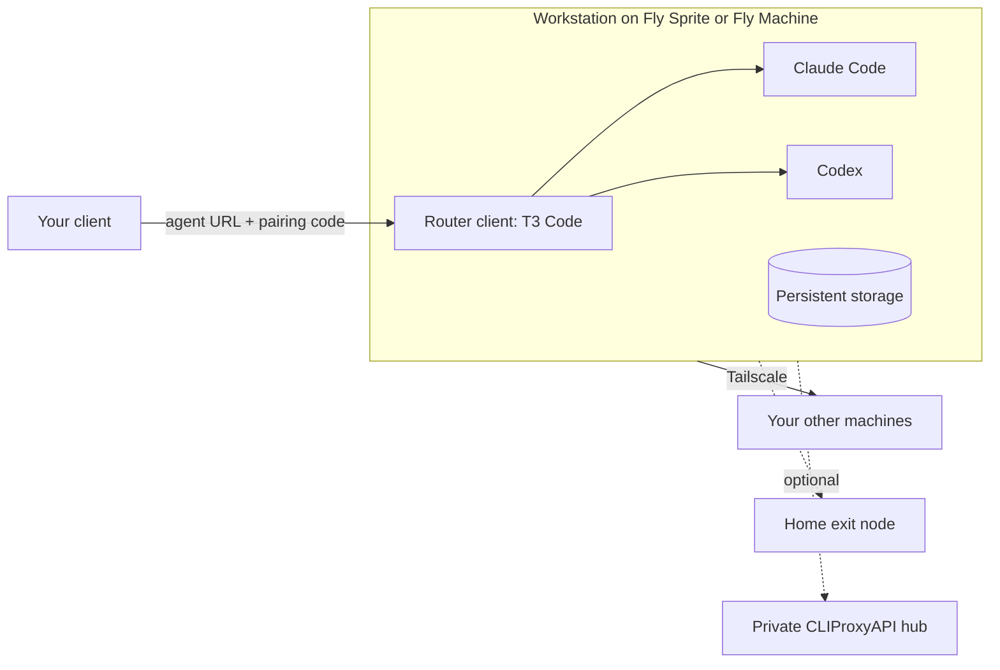
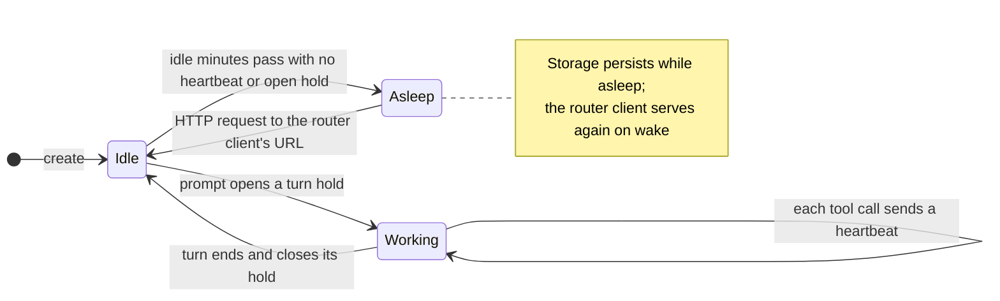

<div align="center">


# open-agent

[](https://www.npmjs.com/package/open-agent)
[](https://github.com/alvis/open-agent/actions/workflows/main.yaml)
[](https://libraries.io/npm/open-agent)
[](https://github.com/alvis/open-agent/blob/main/LICENSE)

**Your coding agent, on its own machine, always within reach.**

_Run a coding agent on a Fly Sprite or Fly Machine that sleeps when idle, wakes when you connect, keeps your work on persistent storage, and reaches your other machines privately over Tailscale. Today its router client is T3 Code, driving Claude Code and Codex._

</div>

> 🧩 **Built on [T3 Code](https://github.com/pingdotgg/t3code), [Fly Sprites](https://sprites.dev/), [Fly Machines](https://fly.io/docs/machines/) and [Tailscale](https://tailscale.com/).** `open-agent` provisions the machine through the official Sprites SDK or the Fly Machines API and flyctl, installs and serves the router client, configures the Claude Code and Codex harnesses in their own native formats, and keeps the machine maintained, asleep when idle and awake while the agent works.

<br/>
<div align="center">

•&emsp;⚡ [Quick Start](#-quick-start)&emsp;•&emsp;💤 [Sleep and Wake](#-sleep-wake-and-persistent-storage)&emsp;•&emsp;🌐 [Private Networking](#-private-networking)&emsp;•&emsp;🔐 [Authentication](#-authentication)&emsp;•&emsp;📖 [Usage](#-usage)&emsp;•&emsp;📚 [CLI Reference](#-cli-reference)&emsp;•

</div>
<br/>

---

## ⚡ Quick Start

Use **Node.js 24 or newer**. Install the CLI from npm, or run it once with `npx`:

```bash
npm install -g open-agent
```

Get a Sprites organization token in `SPRITES_TOKEN` for the default Fly Sprite provider, or a Fly organization token in `FLY_API_TOKEN` for `--provider fly-machine` (see [Prerequisites](#-prerequisites)); each token is needed only by its own provider. Then put an agent on a machine and pair your client with it:

```bash
export SPRITES_TOKEN=…   # or let the interactive run prompt for it and save it on this computer
open-agent create --name my-agent --with-pair-code
```

`create` provisions a private machine, installs the T3 Code router client with the Claude Code and Codex harnesses, verifies readiness and only then exposes it. It returns the agent URL with a native pairing code that is valid for five minutes: open it in your T3 Code client to connect. Later, `open-agent show my-agent --with-pair-code` pairs another client with the same agent.

Interactive creation asks, in order, for the provider, the minimum CPUs and the minimum memory in GB (both default to 2; asked again with the reason when the provider offers no machine that large), the router client (the ACP agent), its release channel (only when the agent declares more than one; T3 Code offers `stable` and `nightly`), harnesses (only those the agent supports), network, then the options those drivers support: an exit node only when the network supports one, CLIProxyAPI only when a selected harness supports it, and idle minutes only when the provider keeps workstations awake. A step with a single choice is skipped. GitHub authentication and Git/Jujutsu identity are separate choices.

To keep credentials for automation in one place, write them to a protected dotenv file (`chmod 600 .env`) and pass it with `--env-file .env`; dotenv files are never loaded otherwise. [.env.example](.env.example) lists every supported environment input and its meaning.

---

## ✨ Why open-agent?

### 😩 The Problem

A coding agent on your laptop stops when the lid closes, and putting one on a remote machine takes more than starting a process:

- **The agent needs a home**: it should keep its sessions, memory and work and stay reachable from whichever device you pick up, without paying for a machine that idles all night
- **Harnesses differ**: Claude Code and Codex have separate native settings, hooks and plugin identities
- **Your other machines are private**: the agent often needs your home server, a database or a model proxy that only lives inside your tailnet, and some traffic should leave through your own exit node
- **The machine drifts**: an agent's tools go stale, and an installation record does not prove the agent and its integrations are healthy now

### 💡 The Solution

`open-agent` turns that into one terminal workflow:

- **Put an agent on a machine**: provision a machine, install and serve the router client with its harnesses, verify readiness, and expose it last
- **Pair any client**: mint a short-lived native pairing code on demand and connect another client to the same agent
- **Sleep when idle, wake on demand**: every harness turn sends heartbeats that keep the machine awake; once no work is left it suspends itself, and the next HTTP request to the router client wakes it
- **Keep your work through every nap**: projects, harness memory, sessions and installed tools live on persistent storage, so they are still there when the machine wakes
- **Join your tailnet**: enroll the machine in Tailscale so the agent reaches your other machines privately, optionally through your exit node and your private CLIProxyAPI hub
- **Keep it maintained**: scheduled in-place updates of the agent, harnesses and tools, and live readiness checks with `doctor`
- **Change one section at a time**: configure the agent, network, GitHub, Git identity, proxy routing, environment variables or native plugins independently, interactively or with versioned JSON output for automation

---

## 🚀 Key Features

| Feature                           | What it gives you                                                                                                                                                                      |
| --------------------------------- | -------------------------------------------------------------------------------------------------------------------------------------------------------------------------------------- |
| **A router client**               | T3 Code on its `stable` or `nightly` channel routes your sessions to the harnesses, served as the machine's only public HTTP service and kept serving across sleep, wake and restarts  |
| **Claude Code and Codex**         | Both harnesses installed for the router client, each with its own native settings, hooks, plugins and optional proxy routing                                                           |
| **Client pairing**                | Opt-in, five-minute native pairing codes on the agent URL, minted at creation or later for each new client                                                                             |
| **Auto-suspend and wake**         | Heartbeat hooks in every harness turn keep the machine awake; it suspends after a configurable idle time and wakes on HTTP traffic to the router client                                |
| **Persistent storage**            | Projects, harness memory, sessions, tools and network enrollment survive sleep: the Sprite's own disk, or a Fly volume that also survives cold boots                                   |
| **Private networking**            | Join your tailnet with Tailscale to reach your other machines privately, route outbound traffic through an approved exit node, and reach a private CLIProxyAPI hub                     |
| **Two providers**                 | Fly Sprites, or Fly Machines with a persistent volume; you set minimum CPUs and memory and the provider runs the smallest machine that fits                                            |
| **Scheduled maintenance**         | Agent, harness and tool upgrades in place once an update is due (default one day, checked hourly), restarting no service |
| **Independent native plugins**    | Repeatable marketplace and plugin actions for Claude and Codex, without converting one harness’s plugins into the other’s                                                              |
| **Six commands**                  | Create, configure, list, show, diagnose, and permanently terminate managed workstations                                                                                                |
| **Live provider discovery**       | Paginated provider queries and exact managed-target checks, without a local machine registry                                                                                           |
| **Readable terminal interaction** | Searchable selectors, labelled back navigation, masked credential prompts, and grouped inspection results                                                                              |

---

## 🧰 Support Matrix

| ✅ Supported | ⚠️ Partial (see note) | ❌ Unsupported | 🔜 Planned |
| ------------ | --------------------- | -------------- | ---------- |

| Capability                     | Support | Notes                                                                                                        |
| ------------------------------ | ------- | ------------------------------------------------------------------------------------------------------------ |
| T3 Code router client (`t3`)   | ✅      | The sole public HTTP service; `stable` or `nightly` channel; a requested pairing code is attached to its URL |
| Other ACP clients              | 🔜      | Planned as further router clients beside T3 Code; router clients are pluggable drivers                       |
| Claude Code harness (`claude`) | ✅      | Native settings, hooks and plugins; optional direct CLIProxyAPI routing                                      |
| Codex harness (`codex`)        | ✅      | Native settings, hooks and plugins, kept separate from Claude's; optional direct CLIProxyAPI routing         |
| Auto-suspend                   | ⚠️      | Harness heartbeat hooks and managed setup/update holds; arbitrary shells and tools can bypass hooks          |
| Auto-wake on HTTP traffic      | ✅      | Both providers wake a sleeping machine on a request to its URL; only traffic-wakeable providers offer it     |
| Persistent storage             | ✅      | Sprite disk; Fly Machine volume holding homes, tools, open-agent state and the apt cache                     |
| Tailscale private network      | ✅      | Joins your tailnet to reach your other machines privately; device cleanup on terminate                       |
| Exit-node routing              | ✅      | Optional; requires an existing approved exit node and permitted access                                       |
| Existing CLIProxyAPI hub       | ✅      | Optional client configuration, reachable inside your tailnet; open-agent does not host a new hub             |
| No private network (`none`)    | ✅      | Default without network input; installs no network tool and registers no network service                     |
| Fly Sprites (`sprite`)         | ✅      | Official SDK; authenticated provider operations and live machine discovery; one 8 CPU, 16 GB size            |
| Fly Machines (`fly-machine`)   | ✅      | Machines API and `fly ssh console`; one app, machine and volume per workstation; resizable                   |
| GitHub authentication          | ✅      | Separate protected native credentials for T3’s `agent` account and a Sprite’s `sprite` account               |

The CLI runs on your computer and requires Node.js 24+. Windows terminals and screen readers are not yet verified.

---

## 💡 Core Concept

`open-agent` puts a coding **agent on a machine**. Each managed **workstation** is one cloud machine with persistent storage whose job is to run a **router client**, the coding harnesses it drives, and the private network it reaches your other machines through. You connect your client to the router client's URL, and it routes your sessions to the harnesses, which do the coding on the machine.

The router client plays the client role of the [Agent Client Protocol](https://agentclientprotocol.com/): it is the one service that talks to you and drives the harnesses as coding agents. Today it is T3 Code, which is not strictly an ACP client but fills the same role, launching Claude Code and Codex through their native CLIs. Other ACP clients are planned as further router clients. The CLI calls the router client the **ACP agent**: `--agent`, `OPEN_AGENT_AGENT` and the agent URL all name it.



A workstation's profile selects one provider, one router client, the harnesses it drives, a network and options. The provider owns its identity, so the CLI discovers workstations from the provider rather than keeping a local registry.

Creation runs in this order:

1. **Resolve inputs and preflight**: validate credentials, configuration, provider identity, and determinable tailnet issues before provisioning
2. **Provision privately**: drive the guest over the provider's channel to install the router client, its harnesses and the managed tools, and configure the selected integrations; tools come from Homebrew prebuilt bottles first, and nothing is built from source
3. **Join the network first**: establish the selected private network before reaching a private proxy hub
4. **Verify readiness, then expose the router client**: check services, routing, proxy access, native configuration, and the router client's environment endpoint before the agent URL is routed publicly

After creation the workstation looks after itself: it stays awake while a harness turn runs, suspends when no work is left, wakes on a request to the agent URL with your work intact (see [Sleep, Wake and Persistent Storage](#-sleep-wake-and-persistent-storage)), and updates the router client, harnesses and tools in place on a schedule (see [Maintenance](#-maintenance)).

`list` and ordinary `show` read the control plane. `show --inspect` and `doctor` explicitly check the guest and may wake it. A stored setup label is not a current health result. `list` queries every provider whose credential is available and reports each other provider as unavailable, its workstation status unknown, naming the token to supply to list them, so one missing credential never fails the list. Every other command looks for the named workstation on each provider whose credential is ready, so you rarely need to name the provider of an existing workstation; when the same name exists on several providers, the command stops with an `INPUT` error that names them. `--provider PROVIDER` on `show`, `doctor`, `terminate` and `setup` names the provider instead and skips that search, so the error never occurs. It is also the provider a `--provider-token-source` belongs to, on `list` too; with a token source and no `--provider`, the source belongs to the default `sprite`.

For how the CLI, the drivers and the guest fit together, see [ARCHITECTURE.md](ARCHITECTURE.md).

---

## 💤 Sleep, Wake and Persistent Storage

The machine runs only while there is work. Each harness turn keeps it awake with heartbeat hooks, it suspends itself once no work is left, and the next HTTP request to the router client wakes it again, with your projects, harness memory and sessions where you left them.



One idle governor decides how long the workstation stays awake, from what the harnesses and the managed operations report. A Claude Code or Codex hook runs the root-owned `/opt/open-agent/guest/awake.sh` command: a prompt (`UserPromptSubmit`) opens a **turn hold**, every tool call (`PreToolUse`) is a **heartbeat** that refreshes it, and the end of the turn (`Stop`, `SessionEnd`) closes it. Managed setup, update and create work opens a **managed hold** of its own, refreshed while the work runs and dropped once its process has exited. The workstation stays awake until the later of the last heartbeat plus the idle timeout (`--idle-minutes`, default 5) and the latest open hold, and no hold lasts longer than `--hold-max-minutes` (default 60) after its last refresh, so a turn whose end hook never fires lapses at that maximum.

- **Sprite**: the deadline is mirrored into a Sprite task (`open-agent-awake`) that expires at the deadline and is removed when nothing keeps the workstation awake. A Sprite task cannot last more than 60 minutes, so `create` refuses an idle timeout or hold maximum above 60 for Sprite.
- **Fly Machine**: once the deadline passes, the governor's per-minute cron tick suspends the machine, or stops it when suspending is ruled out; see [Prerequisites](#fly-machine---provider-fly-machine). A URL request resumes a suspended machine or cold-boots a stopped one.

The command never fails a turn: it exits 0 within eight seconds whatever happens, and every hook allows ten. `show --inspect` and `doctor` report the governor (last heartbeat, open holds, deadline, last adapter result) and whether each harness has all four awake hooks installed. Arbitrary shells, third-party tools, and paths bypassing hooks may not keep the workstation awake.

**Auto-wake.** A sleeping workstation wakes when traffic reaches the router client's URL: opening the agent URL in your client is enough. This needs a provider whose machines are woken by incoming traffic; both Fly Sprites and Fly Machines are, and a provider that cannot be woken by traffic gets no auto-wake.

**Persistent storage.** Everything the agent and you produce stays on persistent storage while the machine naps: your repositories and files, Claude Code and Codex memory, settings, plugins and sessions, the router client's state, the installed tools and the Tailscale enrollment.

- **Sprite**: the Sprite's own disk persists across sleep, so the whole filesystem is kept.
- **Fly Machine**: a suspended machine resumes with its memory intact. A stopped machine loses its root filesystem, so the `agent` and `linuxbrew` homes, `/opt/open-agent` and an apt cache live on the machine's volume, and the boot script binds them back before the router client starts (see [Prerequisites](#fly-machine---provider-fly-machine)).

---

## 🌐 Private Networking

With `--network tailscale`, the workstation joins your tailnet as its own device, named after the workstation. The agent can then reach your other machines (a home server, a database, a build box) over Tailscale without exposing them to the internet, and the only public service on the workstation stays the agent itself.

- **Tailnet access**: supply the tailnet (`TAILSCALE_TAILNET` or `--network-account`) and either a management API key (`TAILSCALE_API_KEY`) or an enrollment key (`TAILSCALE_AUTH_KEY`). The API key stays on your computer; an enrollment key reaches the guest only for enrollment and is then discarded
- **Exit node**: add `--use-exit-node --exit-node NAME` to send the workstation's outbound traffic through an approved exit node, such as one at home, so services see your own address
- **Private model proxy**: add `--proxy` with `CLIPROXYAPI_BASE_URL` and `CLIPROXYAPI_API_KEY` to route both harnesses to an existing CLIProxyAPI hub; a hub inside your tailnet is checked only after the workstation has joined
- **Persistent enrollment**: Tailscale's node state survives sleep and, on a Fly Machine, cold boots; `setup --section network` re-enrolls a daemon that has logged out, and `terminate` removes the device when the API key authorizes it

```bash
open-agent create --name my-agent --env-file .env \
  --network tailscale --use-exit-node --exit-node home-server --proxy
```

Here `.env` holds `SPRITES_TOKEN`, `TAILSCALE_TAILNET`, `TAILSCALE_API_KEY`, `CLIPROXYAPI_BASE_URL` and `CLIPROXYAPI_API_KEY`. Switch an existing workstation onto or off the tailnet with `setup --section all --network tailscale` or `--network none`. [Optional Integrations and Preflight](#optional-integrations-and-preflight) covers tailnet names, exit-node matching and preflight in detail.

---

## 🧾 Prerequisites

Each provider declares the host tools and the management credential it needs. `create` checks them all before any provider call and reports every missing or misconfigured prerequisite, with its fix, in one `INPUT` error; it never provisions half a workstation for a fixable local problem. `list`, `show`, `setup`, `doctor` and `terminate` run the same check for the provider they use.

### Fly Sprite (`--provider sprite`)

- **Host tools**: none; the provider uses the Sprites SDK
- **Credential**: `SPRITES_TOKEN`, a Sprites organization token for the organization that owns the workstations. Get one at [sprites.dev/account](https://sprites.dev/account): sign in with Fly and select the intended organization. `--provider-token-source env:NAME|file:PATH|keychain:SERVICE/ACCOUNT` selects another source; an interactive run can also prompt for it and save it on this computer
- **Scope check**: a Fly API token (`FlyV1 …`, `fm2_…`, `fo1_…`) is refused offline, before any provider call, with the fix above and the source it came from. Any other value goes to the provider; one it rejects fails with `AUTH` and is never saved on this computer
- **Learn more**: [Sprites CLI authentication](https://docs.fly.io/sprites/cli/authentication), [Sprites quickstart](https://docs.fly.io/sprites/quickstart)

### Fly Machine (`--provider fly-machine`)

- **Host tools**: `fly` (flyctl) 0.4.108 or newer on `PATH`; [install or upgrade it](https://fly.io/docs/flyctl/install/). open-agent runs it with its own configuration directory, `$XDG_CONFIG_HOME/open-agent/flyctl`, so your own flyctl login, WireGuard peers and agent are never read or changed
- **Credential**: `FLY_API_TOKEN`, a Fly organization token able to create apps, machines and volumes: `fly tokens create org -o <organization>`. The organization it names owns the workstations. `--provider-token-source` selects another source, as for Sprites
- **Scope check**: before any provider call, flyctl decodes the token offline (`fly tokens debug`); a deploy, SSH or other narrowed token, an expired token, or a value that is not a Fly token is refused with its fix. A Sprites token is refused by its shape without being decoded
- **Placement**: each workstation is one app named after it, holding one machine and one volume, in `OPEN_AGENT_FLY_REGION` or, when unset, the region nearest this computer. Its URL is `https://<name>.fly.dev`, routed only after setup makes it ready
- **Cold boot**: the machine runs `debian:bookworm-slim` with a persistent root filesystem, so a restart keeps its installed packages, and a volume holds both accounts' homes, Homebrew and an apt cache. The machine's init runs a small stub that runs a boot hook kept on the volume. The hook binds the volume back, recreates the `agent` and `linuxbrew` accounts under their original ids, restores the recorded tool links into `/usr/local/bin` and starts `runit`. If the root filesystem was wiped, for example by a move to another host, it first reinstalls the recorded apt packages from the cache. Tailscale keeps its node state on the volume, so a cold-booted workstation stays enrolled; a daemon that has logged out anyway re-joins with `setup --section network`. It logs each step to `/opt/open-agent/boot.log` and `fly logs`, and records the last boot in `/opt/open-agent/boot-status.json`
- **Idle**: the idle governor, run by cron every minute as root, suspends the machine from memory with a `POST` to the guest-local `/.fly/api` socket when the deadline passes, and stops it through the same socket when the machine has more than 2 GB of memory, swap or a schedule, or the suspend is refused. No token is on the guest, and the agent account cannot reach the socket. A URL request resumes a suspended machine or cold-boots a stopped one
- **Guest access**: commands run over `fly ssh console` with a token derived in memory from the organization token; it is never written to disk or sent to the guest. It has full access only to its own app, but it can still read everything in the organization (every app, machine and volume), and it can issue SSH certificates and add WireGuard peers to the organization, because an SSH session needs both. It expires with the organization token
- **WireGuard peer**: the first SSH session creates an organization WireGuard peer, named `interactive-<host>-…`, and stores its private key in `$XDG_CONFIG_HOME/open-agent/flyctl/config.yml`; later sessions reuse it. List the organization's peers with `fly wireguard list <organization>` and remove this one with `fly wireguard remove <organization> <name>`; the next session then creates a new one
- **flyctl agent**: flyctl has no in-process mode, so every SSH session goes through a flyctl agent started from the private configuration directory, and that agent holds the derived token. open-agent runs `fly agent stop` for that directory as soon as its last SSH session ends. If open-agent is killed during a session, the agent keeps running until you stop it with `FLY_CONFIG_DIR=$XDG_CONFIG_HOME/open-agent/flyctl fly agent stop` or restart the computer; your own agent, of `~/.fly`, is never touched
- **Learn more**: [Machines API](https://fly.io/docs/machines/api/), [Fly tokens](https://fly.io/docs/security/tokens/)

---

## 🔑 Environment Variables

### CLI Runtime

Pass `--env-file FILE` for dotenv input. The order is: explicit flags, credential references, selected dotenv values, the process environment, eligible profile/local defaults, prompts, and defaults; a value in the `--env-file` file therefore wins over the same name in the process environment. A malformed flag value is a `USAGE` error. Selection values from every source, option bounds and boolean environment values are then validated together before any provider call: every problem, such as an unknown driver, a malformed number or an out-of-range timeout, is reported in one `INPUT` error.

| Variables                                     | Meaning                                                                                                   |
| --------------------------------------------- | --------------------------------------------------------------------------------------------------------- |
| `OPEN_AGENT_PROVIDER`, `OPEN_AGENT_AGENT`     | Provider and router client (ACP agent) for create; fixed after creation. Other commands take `--provider`; `list` reads all |
| `OPEN_AGENT_HARNESSES`                        | Comma-separated harnesses the router client drives                                                        |
| `OPEN_AGENT_NETWORK`                          | `none` or `tailscale`; `none` keeps the workstation off any private network                               |
| `OPEN_AGENT_CPU`, `OPEN_AGENT_MEM`            | Minimum CPUs and minimum memory in GB, whole numbers from `1`; default `2` and `2`                        |
| `OPEN_AGENT_IDLE_MINUTES`                     | Suspend after this many idle minutes; `0` never suspends                                                  |
| `OPEN_AGENT_HOLD_MAX_MINUTES`                 | Turn-hold lifetime after its last refresh; never prompted                                                 |
| `OPEN_AGENT_UPDATE_DUE_DAYS`                  | Days after the last update before another is due, `1` to `365`; never prompted                            |
| `OPEN_AGENT_USE_EXIT_NODE`                    | Route egress through an exit node on the selected network                                                 |
| `SPRITES_TOKEN`                               | Fly Sprite provider credential; see [Prerequisites](#-prerequisites)                                      |
| `FLY_API_TOKEN`                               | Fly Machine provider credential; see [Prerequisites](#-prerequisites)                                     |
| `OPEN_AGENT_FLY_REGION`                       | Fly region of new Fly Machine workstations; the nearest region when unset                                 |
| `TAILSCALE_TAILNET`                           | Tailnet API ID, full DNS domain, or bare DNS subdomain; required with `--network tailscale`               |
| `TAILSCALE_API_KEY`                           | Local management key for enrollment and authorized device cleanup                                         |
| `TAILSCALE_AUTH_KEY`                          | Optional enrollment key; an auth key alone cannot authorize device deletion                               |
| `TAILSCALE_EXIT_NODE`                         | Existing approved exit-node identity                                                                      |
| `CLIPROXYAPI_ENABLED`                         | Enable or disable direct proxy routing for the selected harnesses                                         |
| `CLIPROXYAPI_BASE_URL`, `CLIPROXYAPI_API_KEY` | Existing hub URL and its client key, required when proxy routing is enabled                               |
| `GH_TOKEN`, `GITHUB_TOKEN`                    | Optional GitHub credential; `GH_TOKEN` wins within the same input source                                  |
| `GIT_AUTHOR_NAME`, `GIT_AUTHOR_EMAIL`         | Explicit Git/Jujutsu author identity                                                                      |
| `GIT_COMMITTER_NAME`, `GIT_COMMITTER_EMAIL`   | Optional distinct committer identity                                                                      |
| `NON_INTERACTIVE`, `CI`, `TERM`               | Interaction controls; automation markers or `TERM=dumb` disable prompts                                   |
| `NO_COLOR`                                    | A nonempty value disables color                                                                           |

[.env.example](.env.example) also explains the process-only `XDG_CONFIG_HOME` and `WAYLAND_DISPLAY` settings. Extra non-reserved dotenv names become explicitly requested guest runtime variables. Process-injection variables and managed-routing overrides are rejected.

### Optional Integrations and Preflight

- **No private network**: choose `none` with `--network none`, `OPEN_AGENT_NETWORK=none`, or the **Network** choice in interactive creation. The workstation then installs no Tailscale tool, registers no `tailscaled` service, and starts the agent service without waiting for a network. Readiness, `show --inspect` and `doctor` report that no private network is selected, and `terminate` has no device to clean up. Tools install and update only for the selected network; switching to Tailscale later with `setup --section network` installs it, and a previously installed network's files stay on disk but are no longer updated
- **Tailscale**: supply the tailnet identity and enrollment authorization when enabled. An API key is needed for authorized device deletion; an enrollment key alone is insufficient. `setup --section network` asks the live Tailscale daemon, not the recorded device, whether the workstation is enrolled: a daemon that has logged out (for example after its state was lost) enrols again with a fresh key minted from the API key, and before enrolling it deletes the device `environment.json` recorded for this workstation, if the tailnet still holds it, so the new device keeps the workstation name instead of `<name>-1`. When the API key cannot delete that device, setup fails and names it. With only an enrollment key, setup cannot check or delete the earlier device
- **Tailnet DNS names**: a bare subdomain is tried as supplied, then retried with `.ts.net` if the device query returns 404. Existing API IDs and full domains are retained
- **Exit nodes**: supply an unambiguous short machine name, device ID, or Tailscale IPv4 address. Short names are matched case-insensitively. Advertising routes is insufficient: enable **Use as exit node** in Tailscale administration and ensure policy permits access
- **CLIProxyAPI**: supply an existing hub URL and client key when enabled. Claude uses the hub root; Codex uses `/v1`. A private hub is checked after joining the tailnet

Interactive creation asks unresolved selection questions. Non-interactive creation infers the network and options from supplied inputs unless an explicit flag or `OPEN_AGENT_*` value overrides them. Setup preserves the recorded profile when omitted; `setup --section all` can change the release channel, harnesses, network and options, and `setup --section agent --release CHANNEL` changes only the release channel, while a different provider or ACP agent is refused because it needs a new workstation. `setup --cpu N --mem GB` (either flag, in any section) resizes the machine to the smallest size meeting the minimums and records them; an omitted one keeps its recorded value. Fly restarts the machine to apply a size, so setup warns that "Resizing NAME to SIZE restarts the machine to take effect; running sessions and processes stop", asks (default no) when interactive, proceeds with `--yes`, and otherwise fails with a usage error before changing anything.

Preflight aggregates determinable issues before provisioning and reminds users about routing, DNS, policy, enrollment expiry, GitHub/Git identity, proxy access, and disruptive updates. Every adapter declares the credentials and tools it needs: the provider's token and host tools, the network's keys and account, the CLIProxyAPI base URL and key, and setup's GitHub token and Git identity. Each command checks the ones it uses, setup included, before it changes anything, and reports every absent input at once, for example `Set SPRITES_TOKEN or pass --env-file FILE containing SPRITES_TOKEN; use --provider-token-source env:NAME, file:PATH, or keychain:SERVICE/ACCOUNT; or run in a TTY to enter it when prompted.` Passing preflight does not replace guest readiness checks.

---

## 🔐 Authentication

### Credential Sources

Supply references rather than raw secret arguments:

- `env:NAME`: read a process environment variable
- `file:PATH`: read a credential file
- `keychain:SERVICE/ACCOUNT`: read a macOS Keychain item

Source flags are `--provider-token-source`, `--network-key-source`, `--network-auth-key-source`, `--proxy-api-key-source`, and `--github-token-source`. The network sources are read only when the selected network uses them.

Provider and network management credentials stay on the invoking computer. Enrollment keys are discarded after enrollment. Selected GitHub and proxy client credentials intentionally persist in protected native guest configuration.

### Show Needs Only the Provider Token

`show` resolves its provider token from an explicit source, selected dotenv file, process environment (in that order), or a token previously saved on this computer. It does not load unrelated integration-profile values. GitHub, Tailscale, and proxy credentials are unnecessary, including for inspection and pairing.

`--no-local-credentials` skips the saved provider-token fallback and prevents saving a prompted token. Environment and explicit file credentials still work. On other commands, it also disables eligible local credential discovery. `--local-credentials` explicitly permits that fallback; neither flag selects another integration.

### Native GitHub Authentication

GitHub access is optional. Eligible local `gh` discovery can supply a default; interactive setup offers use, replacement, or skip. Unverifiable credentials can be retried without printing the token. An explicit invalid automation credential fails instead of falling back to another account.

GitHub setup runs native `gh auth login` with the selected token over stdin, configures HTTPS Git authentication, and checks `gh auth status`. It configures both accounts with separate protected credential stores:

- **`agent`**: the non-root account used by T3
- **`sprite`**: the Fly Sprite provider's default shell account; each provider declares its own shell accounts

`--github-host` selects the GitHub host. Git/Jujutsu author and committer identity are configured separately from GitHub authentication.

### Agent Pairing

Ordinary `show` returns the normal agent URL without creating a code. `--with-pair-code` explicitly mints and discloses a five-minute code in that same URL; T3 Code uses its native `#token=CODE` fragment.

JSON returns the URL as `data.machine.agentUrl`, with the code and expiry in `data.pairing`. There is no separate pairing URL. Human output keeps the URL and code contiguous for copying.

Create, setup and show mint no code by default. `--with-pair-code` is the canonical pairing flag; each ACP agent also accepts its own alias, such as `--with-t3-pair-code` for T3. An alias is rewritten only where it stands as a flag, never when it is the value of another flag. Interactive **Pair another {agent} client** also requests a code explicitly. Setup infers the `agent` section from the flag when no section was selected; it also works with `--section all`, while unrelated sections and plugin actions conflict.

---

## 📖 Usage

Use the interactive CLI to select workstations and configure sections, or pass names and flags for automation. Every command is also available without a global install as `npx open-agent COMMAND`.

### CLI Command Surface

| Command              | Behavior                                                                                                                                                          |
| -------------------- | ----------------------------------------------------------------------------------------------------------------------------------------------------------------- |
| `create --name NAME` | Provision privately, configure the selected drivers, verify readiness and expose the agent; pairing is opt-in                                                     |
| `setup [NAME]`       | Configure one section or explicit actions on a verified managed workstation                                                                                       |
| `list`               | List managed workstations from every provider; providers that cannot be listed are reported as unavailable, and a workstation a newer open-agent set up is marked |
| `show [NAME]`        | Show provider information and the agent URL; inspection and pairing require explicit actions                                                                      |
| `doctor [NAME]`      | Report current service, native harness, and selected-driver readiness                                                                                             |
| `terminate [NAME]`   | Permanently delete the exact managed workstation and report network cleanup separately                                                                            |

Run `open-agent COMMAND --help` for the complete command-specific flag list.

### Common Options

| Flags                                                                                                              | Purpose                                                                                                                                                                                                                                                                                                                                                                                                                                                                          |
| ------------------------------------------------------------------------------------------------------------------ | -------------------------------------------------------------------------------------------------------------------------------------------------------------------------------------------------------------------------------------------------------------------------------------------------------------------------------------------------------------------------------------------------------------------------------------------------------------------------------- |
| `--env-file FILE`                                                                                                  | Select a dotenv file explicitly; no dotenv file is read otherwise, and its values override the process environment                                                                                                                                                                                                                                                                                                                                                               |
| `--json`, `--non-interactive`                                                                                      | Disable prompts; JSON emits one structured final result on stdout                                                                                                                                                                                                                                                                                                                                                                                                                |
| `--yes`                                                                                                            | On create/setup/terminate, approve already-selected actions; termination still requires an explicit target                                                                                                                                                                                                                                                                                                                                                                       |
| `--color` / `--no-color`, `--quiet`, `--verbose`                                                                   | Color, routine-progress suppression and redacted timings                                                                                                                                                                                                                                                                                                                                                                                                                         |
| `--local-credentials` / `--no-local-credentials`                                                                   | Use or skip eligible saved and discovered local credentials, and the saving of prompted credentials                                                                                                                                                                                                                                                                                                                                                                              |
| `--provider PROVIDER`                                                                                              | On create, selects the provider (`sprite` or `fly-machine`; fixed after creation). On `setup`, `show`, `doctor` and `terminate`, names the provider that holds the workstation instead of asking every provider with a ready credential, and is the provider a `--provider-token-source` belongs to (`sprite` when omitted). On `list`, it only names the provider a `--provider-token-source` belongs to; every provider is still listed                                        |
| `--agent`, `--harness` (repeatable), `--network`                                                                   | On create and setup, select the drivers (`t3`, `claude` and `codex`, `none` or `tailscale`); the agent is fixed after creation                                                                                                                                                                                                                                                                                                                                                   |
| `--cpu`, `--mem`                                                                                                   | Minimum CPUs and minimum memory in GB (whole numbers from 1, default 2 and 2); the provider runs the smallest machine it offers that meets both and `create` refuses a minimum it cannot meet. `setup` resizes only when one is given: a Fly Machine restarts to change size, so `setup` warns, asks in an interactive run (default no), proceeds with `--yes` and otherwise fails with a usage error; a size the machine already has changes nothing, and a Sprite has one size |
| `--release`                                                                                                        | Release channel of the ACP agent (T3 Code: `stable`, the default, follows npm `latest`; `nightly` follows npm `nightly`); `setup --section agent` or `--section all` switches it, installs that channel's current version (a downgrade back to `stable`), restarts the agent and waits for readiness                                                                                                                                                                             |
| `--idle-minutes`, `--hold-max-minutes`                                                                             | Idle suspension (`0` never suspends) and turn-hold lifetime                                                                                                                                                                                                                                                                                                                                                                                                                      |
| `--update-due-days`                                                                                                | Days after the last successful update before another is due (`1`-`365`, default `1`); `setup --section tools` or `--section all` changes it                                                                                                                                                                                                                                                                                                                                      |
| `--use-exit-node` / `--no-use-exit-node`, `--exit-node`, `--network-account`                                       | Choose exit routing and its non-secret identities separately                                                                                                                                                                                                                                                                                                                                                                                                                     |
| `--proxy` / `--no-proxy`, `--proxy-url`                                                                            | Enable or disable direct harness proxy routing                                                                                                                                                                                                                                                                                                                                                                                                                                   |
| `--section`                                                                                                        | Select `all`, `agent`, `network`, `github`, `git`, `proxy`, `env` (runtime environment file; skipped without a file or a terminal), `plugins`, or `tools`                                                                                                                                                                                                                                                                                                                        |
| `--plugin-harness`                                                                                                 | Restrict setup plugin actions to one harness                                                                                                                                                                                                                                                                                                                                                                                                                                     |
| `--claude-marketplace`, `--codex-marketplace`, `--claude-plugin`, `--codex-plugin`                                 | Repeatable native source and plugin selections                                                                                                                                                                                                                                                                                                                                                                                                                                   |
| `--remove-claude-marketplace`, `--remove-codex-marketplace`                                                        | Repeatable source removal                                                                                                                                                                                                                                                                                                                                                                                                                                                        |
| `--disable-claude-plugin`, `--disable-codex-plugin`                                                                | Repeatable disablement                                                                                                                                                                                                                                                                                                                                                                                                                                                           |
| `--uninstall-claude-plugin`, `--uninstall-codex-plugin`                                                            | Repeatable removal                                                                                                                                                                                                                                                                                                                                                                                                                                                               |
| `--reuse-marketplaces`                                                                                             | Reuse the first harness's marketplace sources for the other selected harnesses in this operation                                                                                                                                                                                                                                                                                                                                                                                 |
| `--plugins` / `--no-plugins`, `--claude-plugins` / `--no-claude-plugins`, `--codex-plugins` / `--no-codex-plugins` | Permit or skip selected plugin work; enabling does not select a plugin                                                                                                                                                                                                                                                                                                                                                                                                           |
| `--github` / `--no-github`, `--git-identity` / `--no-git-identity`, `--github-host`                                | Permit or skip optional GitHub authentication or Git/Jujutsu identity, and select the GitHub host                                                                                                                                                                                                                                                                                                                                                                                |
| `--git-name`, `--git-email`, `--git-committer-name`, `--git-committer-email`                                       | Set explicit Git identity independently of GitHub authentication                                                                                                                                                                                                                                                                                                                                                                                                                 |
| `--with-pair-code` (per-agent alias such as `--with-t3-pair-code`)                                                 | Create and disclose a fresh code on the normal agent URL                                                                                                                                                                                                                                                                                                                                                                                                                         |
| `show --inspect`                                                                                                   | Inspect live guest configuration; may wake the guest and take longer                                                                                                                                                                                                                                                                                                                                                                                                             |
| `setup --section tools --update`                                                                                   | Explicitly update managed developer tools in place; running services are not restarted                                                                                                                                                                                                                                                                                                                                                                                           |

`--quiet` suppresses routine progress and informational status; warnings, errors, prompts and final results remain. Explicit `--verbose` diagnostics still appear on stderr with quiet.

Options are command-specific: configuration flags belong to create/setup, and removal/disable/uninstall actions belong to setup. Paired flags are mutually exclusive when both polarities are supplied. See [CLI Reference](#-cli-reference) for streams, errors and exit codes. Missing required input includes the actual terminal reason when prompts were disabled implicitly, such as redirected stderr; supply flags or rerun with usable terminal streams.

### Interactive Navigation

`show` offers details, pairing, inspection, section configuration, URL copying, and termination. **Copy {agent} URL** (for example **Copy T3 Code URL**) writes to the clipboard without opening a browser. **Inspect workstation** shows progress and grouped service, networking, harness, plugin, and provider results; it can take tens of seconds when waking the guest or initializing harnesses.

Escape returns to the labelled parent menu before changes begin; Ctrl+C requests cooperative cancellation and recovery. A second interrupt forces exit 130; pending remote work may continue, so inspect any reported resource before retrying. Plugin actions survive local back steps. After setup changes the guest, stopping reports incomplete setup instead of replaying mutations.

Selectors explain disabled choices and require confirmation before accepting an empty multi-selection. With an active search, type spaces normally and press Tab to toggle; when search is empty, Space also toggles. Hidden-item counts indicate scrolling. Secret entry always displays a fixed `(hidden)` mask.

The **Network** section separates guest networking from **Replace saved API key on this computer**, which changes a shared local credential. **Managed tools** defaults to recorded versions; **Update tools now** asks for confirmation. Git identity offers keep/edit/skip with existing values as defaults and previous-field navigation.

### Example: Inspect and Pair Another Client

List managed workstations, read provider details, then request live readiness or pair a new client with the agent:

```bash
open-agent list --env-file .env --json
open-agent show my-agent --env-file .env --json
open-agent doctor my-agent --env-file .env --json
open-agent show my-agent --env-file .env --with-pair-code
```

`list` and ordinary `show` do not wake the guest. A full setup takes about 32 to 40 minutes on Fly and about 7 minutes on a Sprite; without a terminal it streams each step as a status line on stderr. Add `--inspect` to show for explicit guest checks, or `--json` to the pairing command for structured output. The executable flushes both streams before exiting.

### Example: Configure Native Plugins

Register the same GitHub marketplace independently for both harnesses, then enable the selected native plugin identities:

```bash
open-agent setup my-agent --env-file .env \
  --claude-marketplace alvis/.agents --codex-marketplace alvis/.agents \
  --claude-plugin essential@alvis --claude-plugin coding@alvis \
  --claude-plugin specification@alvis --claude-plugin governance@alvis \
  --codex-plugin essential@alvis --codex-plugin coding@alvis \
  --codex-plugin specification@alvis --codex-plugin governance@alvis
```

Explicit plugin actions infer `--section plugins`; a conflicting section errors. All four marketplace/plugin input flags and every removal/disable/uninstall action are repeatable. A selection for one harness does not select it for the other.

```bash
open-agent setup my-agent --env-file .env \
  --disable-claude-plugin coding@alvis \
  --uninstall-codex-plugin coding@alvis
```

`--reuse-marketplaces` takes the marketplace sources of the first harness, in catalog order, that has any and applies them once to the other selected harnesses; it reuses sources only for the requested operation. Skip flags alone select no operation. Unrelated native settings and plugins are preserved.

### Example: Recover or Update the Machine

Recover an incomplete installation or explicitly refresh managed tools:

```bash
open-agent setup my-agent --env-file .env --section all
open-agent setup my-agent --env-file .env --section tools --update
```

Full setup updates tools and configures all areas. `--section env` writes the runtime environment file that `--env-file` names to the guest; without `--env-file` it asks for a file path in a terminal, and without a terminal it skips the section, reports it as skipped and exits 0 (`--section all` behaves as before). For a smaller repair, select the relevant section, such as `--section github`. Failures include bounded redacted diagnostics, the failed section, and a retry command. A successful targeted retry does not establish full readiness or clear the global incomplete-setup marker.

A failed create retains a visible resource and reports its identity. Recover it instead of creating another machine blindly. Interactive full setup preserves the recorded profile as Enter defaults; new creation defaults to no network and no proxy when unresolved. Explicitly disable managed routing with `--no-proxy` or `--network none`.

Termination permanently deletes the selected managed workstation. The CLI validates its exact identity before deletion and reports associated network cleanup separately; cleanup requires its own management authorization.

---

## 📚 CLI Reference

The package exposes the `open-agent` executable. It has no importable SDK surface. Run `open-agent --version` without authentication, and use command-specific `--help` for accepted flags and value labels.

### Output and Exit Codes

| Output                           | Destination and format                                                                                          |
| -------------------------------- | --------------------------------------------------------------------------------------------------------------- |
| Human success                    | stdout, readable workstation details                                                                            |
| Human failure or cancellation    | stderr, including recovery identity when known                                                                  |
| `--json`                         | Exactly one final stdout object with `schemaVersion: 1`, `command`, `ok`, and success `data` or failure `error` |
| Progress and verbose diagnostics | stderr; diagnostics redact resolved secrets                                                                     |
| Piped `list`                     | Headerless TSV, one workstation per line; an empty list emits no text                                           |

TSV column order is `name`, `id`, `state`, `createdAt`, `agentUrl`, `setup`, `organization`, `provider`. Each unavailable provider adds an `Unavailable provider NAME: REASON` line on stderr, and each workstation a newer open-agent set up adds `Workstation NAME was set up by open-agent X; upgrade open-agent to manage it`; `--json` lists the providers under `unavailable` with their `provider`, error `code` and `reason`, and marks the workstation with `newerRelease`. Every other command still refuses such a workstation. When every provider fails with the same error code, `list` exits with that code. Missing values are empty. Backslashes, tabs, line feeds, carriage returns, ESC and CSI characters are escaped as `\\`, `\t`, `\n`, `\r`, `\u001b` and `\u009b`, so a field cannot split a record or inject ANSI control sequences. `--json` takes precedence over TSV.

| Exit  | Meaning                                                                    |
| ----- | -------------------------------------------------------------------------- |
| `0`   | Command succeeded                                                          |
| `1`   | Input, authentication, preflight, conflict, provider or unexpected failure |
| `2`   | Invalid command usage                                                      |
| `130` | Cancelled                                                                  |

JSON `error.code` is one of `USAGE`, `INPUT`, `AUTH`, `PREFLIGHT`, `CONFLICT`, `PROVIDER`, `CANCELLED` or `UNEXPECTED`. Missing credentials are input errors; rejected supplied credentials are authentication errors. Human and JSON modes use the same exit statuses. JSON cannot be combined with help or version output.

### JSON Payloads

Successful results use `{ "schemaVersion": 1, "command": "…", "ok": true, "data": { … } }`. Optional fields are omitted when unavailable. A workstation summary contains `id`, `name`, `organization`, `state`, `setup` and `readiness: "not inspected"`, plus optional `createdAt`, `agentUrl`, the recorded `profile` and `machine`, the size the workstation runs on as `{ label, cpus, memoryGb }` (for example `shared-cpu-2x`, 2 CPUs, 2 GB). The minimums a workstation was created or last resized with are `environment.profile.options.minCpus` and `minMemoryGb` in `show --inspect` and `doctor`. Automation keeps the field name `machine` even though the terminal calls it a workstation.

| Command     | Fields in `data`                                                                                                                                                                                                                       |
| ----------- | -------------------------------------------------------------------------------------------------------------------------------------------------------------------------------------------------------------------------------------- |
| `create`    | `machine`, `preflight`, `integrations`, `readiness`, `network`, `hub`, `services`, `native`, `pairing`; optional `retainedCredentials`                                                                                                 |
| `list`      | `machines`, an array of live workstation summaries each with its `provider` and, for one a newer open-agent set up, `newerRelease`, and `unavailable`, an array of `{ provider, code, reason }` for providers that could not be listed |
| `show`      | `machine`; optional `inspection`, `pairing`, or interactive `action: "copy"`                                                                                                                                                           |
| `setup`     | Guest setup: `machine`, `section`, the section fields below, and optional `retainedCredentials`. Local credential replacement: `localCredential` with `status`, `scope`, optional `storage` and `fallbackReason`; no `machine`         |
| `doctor`    | `machine`, `currentReadiness` with readiness findings, `network`, `hub`, `native`, `services`, `environment`, `updates`, `governor` and, where the provider has a boot hook, `boot`                                                    |
| `terminate` | `machine`, `workstation` with `status: "deleted"`, `id` and `name`, and `network` with cleanup `status` and optional `deviceId`/`address`                                                                                              |

Guest setup section fields are `pairing` and optional `service` for `agent`; `network` for `network`; `github` for `github`; `gitIdentity` for `git`; `proxy` for `proxy`; `runtimeEnvironment` with variable **names** for `env`; `plugins` with an independent outcome per harness for `plugins`; and `tools` for `tools`. Section `all` combines the selected section outcomes. Tool results distinguish `updated`, `unchanged`, and recorded version/time details. Services report names and states without executable arguments.

Failures use `{ "schemaVersion": 1, "command": "…", "ok": false, "error": { "code": "…", "message": "…" } }`; `command` is `null` when parsing cannot identify it. `error` may include redacted `details`, `machine`, `machineId`, `setupIncomplete` and `outcome: "retained" | "absent" | "unknown"`. Optional failure `data` retains observed facts: create preflight/readiness/recovery, setup readiness/recovery, doctor readiness, or terminate deletion/cleanup outcomes. A failure can therefore identify a retained workstation or a workstation already deleted before network cleanup failed.

Pairing disclosure is opt-in and structurally marked. Other resolved credentials remain redacted from final results, diagnostics and recovery messages. A failed command can retain a workstation; inspect the reported identity before retrying a mutation.

---

## 🛠️ Machine Reference

The agent works with these tools on the machine. They are supporting equipment for the agent and its harnesses, installed and updated with them.

### Installed tools

Every workstation gets these tools for the `agent` account. Homebrew's directories come first on the agent's `PATH`, and Homebrew executables the system lacks are also linked in `/usr/local/bin`:

| Tool                 | Commands                                                        | Source                                     |
| -------------------- | --------------------------------------------------------------- | ------------------------------------------ |
| Git, Jujutsu, GitHub | `git`, `jj`, `gh`                                               | Homebrew bottles                           |
| Node.js              | `node`, `npm`, `npx`                                            | Homebrew `node`, its Current release line  |
| pnpm                 | `pnpm`, `pnpx`                                                  | Homebrew bottle                            |
| Python               | `python3`, `pip3`, `python`, `pip`                              | Homebrew `python3`, the current release    |
| uv                   | `uv`, `uvx`                                                     | Homebrew bottle                            |
| Rust                 | `rustup`, `cargo`, `rustc`, `rustfmt`, and more                 | Homebrew `rustup`, with a stable toolchain |
| HTTPie               | `http`, `https`, `httpie`                                       | Homebrew bottle                            |
| agent-browser        | `agent-browser`                                                 | Homebrew bottle                            |
| Search and JSON      | `rg`, `jq`                                                      | Homebrew bottles                           |
| Google Chrome        | `google-chrome`                                                 | `google-chrome-stable` from Google's apt   |
| C compiler           | `gcc`, `libc6-dev`                                              | Debian packages, so cargo and pip can link |
| Network diagnostics  | `ping`, `telnet`, `dig`, `nc`, `traceroute`, `ip`, `ss`, `wget` | Homebrew bottles                           |

The Node.js on the agent's `PATH` is Homebrew's Current line; there is no separate open-agent Node on the guest. Each tool lists its sources in order (Homebrew, then a system package, npm or rustup), and a Homebrew formula without a bottle for the guest's architecture falls through to the next source. A required tool with no usable source stops `create` at preflight; an optional one is skipped and recorded, and `show --inspect` reports it. The Rust toolchain is the `stable` channel with the minimal profile plus `clippy` and `rustfmt`, installed in the agent's home by `rustup`. Google Chrome is the `google-chrome-stable` package from Google's signed apt repository, with its libraries from Debian; agent-browser finds it as `google-chrome` on the `PATH`, so it never downloads a browser of its own. `show` and `doctor` report each tool's version.

---

## 🔧 Maintenance

A Sprite runs `t3-code` and `open-agent-cron` as Sprite services, plus `tailscaled` when Tailscale is selected. A Fly Machine has no init system, so its boot hook ends by running `runsvdir`, and `runit` supervises `t3-code`, `tailscaled` and `open-agent-cron`, restarting one that exits and starting them again after a cold boot. Their output goes to `/var/log/open-agent`, and `doctor` reads their status with `sv`. T3 is the only public HTTP service; administration uses authenticated provider interfaces.

The idle governor, the awake hooks and storage across sleep are covered in [Sleep, Wake and Persistent Storage](#-sleep-wake-and-persistent-storage).

What the guest keeps for itself is a set of small POSIX `sh` programs under `/opt/open-agent`: the launchers, the idle governor and its provider adapters, the update gate and the updater. Setup does not leave a program on the guest to finish its own work: the host sends each step over the provider's channel and checks it before the next. The one record setup leaves, `/opt/open-agent/environment.json`, holds the open-agent version, the setup state, the OS family, each tool with its source and the update schedule. `update-status.json` beside it records the last update. A workstation set up by a newer open-agent is refused by every command until you run that version or newer.

**Updates.** While the workstation runs, cron starts the update gate every hour, and once **one day** has passed since the last successful update the gate runs the updater, which upgrades each recorded tool through its own manager: system packages with `apt-get install --only-upgrade`, Homebrew formulae from a bottle, npm tools by dist-tag and the Rust toolchain with `rustup update`. A tool that is already current is skipped, and the updater never installs a tool that is missing. The agent follows the npm dist-tag of its recorded release channel (`stable` unless another was selected). Change the interval with `--update-due-days` (1 to 365); `setup --section tools` or `setup --section all` changes it on a live workstation without restarting a service, and a run that only changes the interval reports `tools: "scheduled"`. `setup --section tools --update` runs the updater now. The success time advances only after every required tool succeeded; `show --inspect` and `doctor` report the last run and any failed tool under Maintenance alongside the `Agent release channel`.

**No service restarts.** The updater never stops, starts, restarts, registers or deletes a service, so a running agent or network daemon keeps its process; a newly installed version runs the next time the service restarts, which `setup --section agent --release CHANNEL` and `setup --section all` do when the release channel changed. Updates can still interrupt active work: there are no compatibility, staging, or safe-point gates. Project dependencies, the guest distribution, and the provider runtime are outside the maintenance scope.

---

## 📄 License

**MIT** [Alvis HT Tang](https://github.com/alvis)

Free for personal and commercial use. See [LICENSE](LICENSE) for details.

---

<div align="center">

**[⭐ Star on GitHub](https://github.com/alvis/open-agent)** · **[📦 View on npm](https://www.npmjs.com/package/open-agent)** · **[📖 Documentation](https://github.com/alvis/open-agent#readme)**

_Built for developers who want their agent to keep working long after they close the laptop._

</div>
