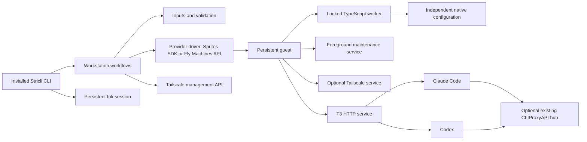

# Workstation architecture

open-agent is a Node 24+ CLI that creates and manages persistent coding workstations on Fly Sprites or Fly Machines through a layered workflow. Root workflows coordinate domain modules, provider drivers and narrow external integrations; an installed guest runs T3 Code, scheduled maintenance (cron on a Sprite, the guest supervisor's timer on a Fly Machine) and optional Tailscale. [ARCHITECTURE.md](../../ARCHITECTURE.md) is the shorter maintainer's guide to the same structure. Claude and Codex keep separate native configuration and plugin identities.

## File structure

The tree includes every root source module and the principal nested boundaries; nested leaf listings are selective.

```text
bin
  cli.mjs                     # Installed executable and last-resort output boundary
scripts
  packed-cli.ts               # Shared build, pack, install and execution runner
  process-group.ts            # Child process-group signalling and drain
  source-hooks.ts             # Source `.js`-to-`.ts` resolution for the runner
src
  command.ts                  # Internal result and interaction contracts
  command                     # Typed command options and concrete result data
  create.ts                   # Private provisioning workflow
  create                      # Preflight, configuration, completion and recovery
  errors.ts                   # Typed error codes, safe causes and exit mapping
  input.ts                    # Input-resolution entry point
  input                       # Credentials, source precedence and optional choices
  inspect.ts                  # Live list/show and current doctor observations
  machine.ts                  # Provider-derived workstation summaries and names
  navigation.ts               # Safe back/cancel navigation contract
  navigation                  # Typed navigation exits
  operation.ts                # Invocation lifetime, cancellation, identity and tracing
  plugins.ts                  # Per-harness plugin selection contract
  readiness.ts                # Observed readiness assessment
  setup.ts                    # Configuration and incomplete-installation recovery
  setup                       # Section selection, shared configuration and failure recovery
  terminate.ts                # Exact-target deletion and separate tailnet cleanup
  validation.ts               # Determinable input and command conflict checks
  workstation.ts              # Validated internal workflow dispatch
  workstation                 # Shared configuration order and safe action-menu requests
  cli                         # Non-JSX Stricli, output and real terminal adapters
    application.ts            # Application metadata and supported help formatting
    commands.ts               # Six command definitions and examples
    execute.ts                # Command-owned mode, cancellation and output lifetime
    flags.ts                  # Command-specific flags and value placeholders
    interaction.ts            # One Ink root and queued prompts
    output.ts                 # Prepared stream output, readable results and TSV
    reporting.ts              # Real stage/status reporting and quiet filtering
    activity.ts               # Persistent-root active-stage state
    serialization.ts          # Versioned, structurally safe final JSON
  components                  # All React/Ink views, prompts and presentation bridges
  core                        # Driver registry, selection, profile and derived service helpers
    catalog.ts                # Typed registry of providers, harnesses, agents and networks
    guest-leaves.ts           # Guest facts of every driver, read before any driver loads
    guest-catalogs.ts         # The harnesses.json and components.json data catalogs
    providers.ts              # Binds a provider to its credential and the services core lets it restore
  drivers                     # One folder per driver: src/drivers/<kind>/<id>/
    contracts.ts              # Provider, harness, agent and network driver contracts
    agents                    # ACP agents; t3/ owns install, service, pairing, environment inspection and readiness
    harnesses                 # Claude and Codex configuration, proxy routing and plugins
    networks                  # Private networks; none/ is the no-op network, tailscale/ owns preflight, enrolment, daemon and cleanup
    providers                 # Workstation hosts; sprite/ owns the Sprites SDK integration, fly-machine/ the Machines REST API and `fly ssh console` channel
    shared                    # Helpers several drivers use; cliproxyapi/ holds the proxy hub client
    <kind>/<id>/guest         # Compiled for the guest and staged from lib/drivers/<kind>/<id>/guest/*
    <kind>/<id>/guest-modules.ts  # Dependency-free list of that driver's guest modules
    <kind>/<id>/guest-leaf.ts     # Dependency-free guest facts of that driver, which the driver spreads
  integrations                # External APIs, credentials and guest/native boundaries
    clipboard.ts              # Local clipboard for the copied agent URL
    marketplaces.ts           # Marketplace source compatibility checks before plugin changes
    credentials.ts            # Local native secure storage and protected-file fallback
    guest                     # Guest runtime, services, files and locked transactions
    native                    # Independent Claude/Codex, GitHub/Git and T3 configuration
  guest                       # Guest kernel: TypeScript compiled for guest deployment under /opt/open-agent/guest
    bootstrap-node.sh         # Checksum-verified private Node bootstrap
    update-gate.sh            # Per-minute gate that lets one update check through per interval
    guest-transaction.ts      # Serialized payload staging and configuration worker
    guest-root.ts             # Guest root constants and the helpers that name a module by its deployed path
    install-tools.ts          # Managed stable-tool installation
    updater.ts                # Scheduled/explicit in-place update and truthful status recording; touches no service
    component-catalog.ts      # Reader for the components.json data catalog
    harness-catalog.ts        # Reader for the harnesses.json data catalog
  utilities                   # Non-React guards, processes, input files and redaction
spec
  e2e                         # Unmocked installed CLI, native PTY and guest-worker checks
  fixtures                    # Real stream/terminal and temporary-file helpers
  mocks                       # Unit-only official Sprites SDK mock
  cli                         # Source-mirrored CLI unit specs
  components                  # Real Ink component unit specs
  integrations                # Source-mirrored native/provider unit specs
```

## Main components

- **CLI entry point** (`bin/cli.mjs`, `src/cli/application.ts`): loads the installed compiled Stricli application. The package exposes only its executable; internal workflow functions are not a public SDK.
- **Execution boundary** (`src/cli/execute.ts`, `src/operation.ts`): resolves interaction before effects, owns cancellation and retains observed resource identity for recovery. One invocation-scoped context prevents work from starting after its owner closes.
- **Interactive session** (`src/cli/interaction.ts`, `src/components/InteractionRoot.tsx`): keeps one Ink root mounted across a prompt queue. Rendered components collect input and display state; workflows own cloud mutations.
- **Inputs and validation** (`src/input.ts`, `src/validation.ts`): apply explicit-source precedence, resolve eligible fallback credentials lazily and aggregate determinable preflight issues before provisioning.
- **Workstation workflows** (`src/create.ts`, `src/setup.ts`, `src/workstation/configuration.ts`): share ordered native configuration steps, preserve unrelated settings and retain failed resources for recovery.
- **Provider drivers** (`src/drivers/providers/sprite/provider.ts`, `src/drivers/providers/fly-machine/provider.ts`): authenticate, paginate live records and check management/organization identity through the Sprites SDK or the Fly Machines API. Termination revalidates the immutable target identity immediately before deletion.
- **Guest transactions** (`src/integrations/guest/transaction.ts`, `src/guest/guest-transaction.ts`): serialize configuration, payload and manifest operations under one guest installation/update lock. Updater writes reread current state and merge only updater-owned fields.
- **Native integrations** (`src/integrations/native/claude.ts`, `src/integrations/native/codex.ts`): merge real JSON/TOML and apply independently selected native sources/plugins. Shared reconciliation keeps harness differences explicit.
- **Runtime inspection** (`src/integrations/guest/runtime.ts`): checks services, routing, native configuration and the T3 environment endpoint without a paid model turn. Probe failures become findings rather than disappearing or aborting unrelated observations.
- **Maintenance** (`src/guest/updater.ts`): installs managed stable tools in place when due, records their versions and advances the success time only after every required install succeeds. It never stops, starts, restarts, registers or deletes a service.

## Dependency and execution flow



1. Validate known input/mode conflicts, resolve selected credentials and preflight provider/tailnet facts before provisioning.
2. Provision privately, acquire the guest lock and bootstrap checksum-verified Node when needed. Fixed inline shell glue holds the lock while the compiled worker starts; the TypeScript worker stages the remaining payloads and processes requests.
3. Install managed developer tools, join the selected tailnet before accessing a private proxy, then merge native settings and plugins.
4. Start services and assess current route, DNS, proxy and the T3 service and its `/.well-known/t3/environment` response.
5. Make T3 public after readiness succeeds. Mint a native code last only for an explicit pairing request.
6. Ordinary list/show read the control plane. `list` covers every registered provider with a credential and notes the rest as skipped; a command without `--provider` asks each ready provider for the workstation (`src/core/provider-lookup.ts`) and refuses only when the name exists on several. `--provider` on `setup`, `show`, `doctor` and `terminate` skips that search, and on every command, `list` included, it names the provider a `--provider-token-source` belongs to (`sprite` when omitted). Explicit inspection and doctor execute guest checks and may wake the workstation.

External integrations may depend on owning leaf contracts and permitted helpers, but cannot import application workflows or CLI implementations. Guest scripts form a separately deployable boundary: only permitted built-ins, `ws`, other guest code and the guest kernel may be imported, and driver guest code imports the kernel by the same relative specifier in the source tree and on the guest. Components never own cloud effects. These import directions are reviewed as architectural constraints; the project registers no custom ESLint boundary rule. Package subpath imports resolve module locations and do not enforce dependency direction.

## Packaging and local execution

Source `imports` resolve `#*` to `src` and `#components/*` to TSX. `publishConfig.imports` resolves the same aliases exclusively to compiled `lib` output when pnpm packs the package. Consequently, invoking the checkout bin against compiled files is not supported.

`scripts/packed-cli.ts` is the common runner for local use and packaged end-to-end checks. It builds, packs and installs a temporary tarball, then runs the installed bin with the caller's arguments, environment, working directory, signals and exit status. The manifest stays private and no release workflow is supplied.

Guest TypeScript is compiled into `lib/guest` for the guest kernel and `lib/drivers/<kind>/<id>/guest/*` for payloads a driver owns. The guest root `/opt/open-agent` holds a mirror of that compiled tree (`guest/*` and `drivers/<kind>/<id>/guest/*`), so a relative import from driver guest code to the kernel is the same specifier in the source tree, the package and the deployed guest. A module's name is its path under the guest root, which makes names unique by construction, and a driver may only declare modules inside its own guest folder. Every directory of the mirror is 0755 and every module is root-owned: 0700 when only root runs it, 0755 when another account runs or reads it. `src/core/guest-leaves.ts` is the one registry of each driver's dependency-free `guest-leaf.ts`; the guest payload inventory and the guest data catalogs derive from it, and `src/core/catalog.ts` checks at compile time that each driver kind registers exactly the drivers the leaf registry holds, except the `none` network, which has no guest leaf because it deploys no module. A network declares what it needs as facts of its driver: a daemon, an installer, caller inputs and exit-node support. The `none` network declares none of them, so the guest component catalog lists only the selected network's installer (nothing for `none`), the installer and the version probes cover only that network, and the agent service depends on a network daemon only when the selected network declares one. Selecting `none` therefore installs no network binary and registers no network service. Module staging stays independent of the profile, so every driver's modules are staged but only the selected network's tool is installed; setup that switches to a network the workstation never installed installs it first. A network's release installer is a root guest module of its own driver, which the core installer loads by the name the component catalog records and calls with the download, link, run, scratch-directory and tools-directory helpers core lends it. The explicit postbuild asset step adds only `bootstrap-node.sh`; deployment reads compiled payloads from the installed package. No broad source-directory copy or source-checkout dependency is required.

## State, ownership and recovery

Provider labels identify management/schema and completed versus incomplete setup. Name, immutable ID, organization, creation time and provider URL come from live provider records. No local workstation registry replaces that state.

Detailed non-secret installation state lives in `/opt/open-agent/manifest.json`: versions, enabled integrations, maintenance time and managed tailnet identity. Separate private ownership records retain native proxy fields for safe restoration. Disablement restores only unchanged manager-owned values, preserving user edits and unrelated settings.

Full setup can recover an incomplete installation. Node availability alone does not mean installation completed. A targeted section repair does not assert global readiness or silently clear an incomplete label. During create, a final pairing failure after readiness/exposure succeeded preserves the ready workstation; an earlier failure attempts private visibility and reports the actual restoration/label outcome. Setup failures retain their section and incomplete-label outcome. Full setup marks READY only after its requested pairing step succeeds.

A Fly Machine resets its root filesystem whenever it stops, so everything the installer keeps lives on the machine's volume, mounted at `/data`, and a boot script rebuilds the rest on every boot, the first create's included. The machine configuration's `files` field writes the script to `/usr/local/sbin/open-agent-boot` on the root filesystem with mode 0755, and the machine runs it as its init; its source is POSIX sh rendered from the guest constants under `src/drivers/providers/fly-machine/guest/`. The script requires `/data` and each directory it binds root's to be root's alone, then bind-mounts `/data/open-agent`, `/data/home/agent` and `/data/home/linuxbrew` over `/opt/open-agent`, `/home/agent` and `/home/linuxbrew`, so every path, realpath included, is the one the installer and Homebrew's bottles expect. It recreates the `agent` account (fixed ids 1000:1000) and the `linuxbrew` system account (999:999, no login shell, locked password, no sudo rule, no other group) under the ids their surviving homes were made under, refusing ids another account or group holds and never changing an owner; a fresh volume gets a private agent home from the skeleton and an empty root-owned Homebrew home, which the installer takes over. No sudo rule is written, as the installer writes none. apt keeps its lists and downloads in `/data/apt`, and an apt hook records on the volume every package installed beyond the image's own; each boot reinstalls them from that cache without `apt-get update`, leaving out `cron`, which a supervised provider never uses. Tailscale keeps its node identity and managed resolver files in `/opt/open-agent/state/tailscale` (root-only, mode 0700), on the volume, so a cold boot keeps the enrollment; the launcher creates that directory and `/var/run/tailscale` itself before it prepares anything, since the root filesystem has just been rebuilt, and its restore step skips any recorded transport rule the new kernel no longer holds. A workstation that enrolled at the earlier `/var/lib/tailscale` re-enrolls once with `setup --section network`. `setup` decides enrolment from the live daemon (`Self.ID`), never from the manifest's recorded device, which is cleanup data only: for a logged-out daemon it mints a fresh key from the management API key and, first, deletes the recorded device if the tailnet still holds it, so the new device keeps the workstation name; if that deletion is refused, setup stops and names the device. The boot script then restores the links in `/usr/local/bin` by replaying the installer's record, `/opt/open-agent/links` (see the install paragraph below), and writes `/etc/profile.d/open-agent.sh`; the script holds no list of tools, so adding a tool never needs a new boot script, which Fly writes into a machine's configuration only when the machine is created. The record is refused unless it is a regular file root alone can write; a line is restored only when its path is directly in `/usr/local/bin` under a safe name and its target is an absolute path that exists, and any other line is skipped with a log line. Before the installer has linked anything there is nothing to restore. Each step's outcome and duration goes to the console, which `fly logs` keeps, and to `/opt/open-agent/boot.log`; the last boot's result is `/opt/open-agent/boot-status.json`, and `/run/open-agent/boot-ready` carries the boot's id and `ok` or `failed`. The host opens the guest channel only once that file names the current boot, so the bootstrap and the installer never run before the volume paths are in place, and a failed boot is reported with the log's path. Once done, the script runs the guest supervisor `/opt/open-agent/bin/open-agent-supervisor` if it is a root-owned executable no other account can change, and otherwise waits for it without exiting, since the machine stops when its init exits. A failed optional step (the apt cache, the packages, the links or the profile) leaves the boot status `failed` for doctor but still hands over; only a failed critical step (the volume, the guest root or an account) halts the boot, which then waits ten minutes for the log to be read and stops the machine through the guest-local Machines API, using Perl because the image has no curl at that point, and retries that request every ten minutes while the machine runs. Nothing on the path compiles anything.

Termination captures the exact managed tailnet identity before Sprite deletion and reports node cleanup independently. A failed or ambiguous query is never absence proof. Destructive consent belongs to the exact request: navigating from show to terminate clears inherited consent and requires its own target confirmation.

## Privilege and credentials

Root installation operations use trusted managed paths. Every module under `/opt/open-agent` is staged root-owned and unwritable by other accounts: 0700 for root-only entry points and 0755 for modules other accounts execute. No module is handed to another account, because root imports modules that agent-run code shares. Agent tools and native probes execute through the unprivileged account; recursive ownership/configuration work refuses symlinks instead of following them into unrelated paths. Guest mutations share the transaction lock, including native and manifest writes.

Sprites, Fly and Tailscale management tokens remain local. Enrollment uses a transient private file that is removed after use. Selected GitHub and proxy client credentials intentionally persist in protected native guest configuration. Native GitHub authentication configures separate `agent` and provider-shell `sprite` accounts.

Optional credentials are resolved lazily, so an explicit usable source does not fail because an unused saved store is malformed. Storage outcomes report the actual native or protected-file backend. Original work errors retain bounded redacted causes and independently reported restoration/storage failures.

No Sprites connector feature exists. CLIProxyAPI is an existing optional hub: enabled Claude and Codex routing uses their supported native interfaces; disabled routing leaves native sign-in/configuration. Harness configuration records the selected gateway's model-catalogue endpoint and client key in a root-only `/opt/open-agent/cliproxyapi.json`, removed when routing is off; the hub probe runs as root against that record and reports a missing record as an unreachable gateway. The manager generates no static model menu or additional hub.

## Cancellation and output

The CLI owns one physical-interrupt authority. First interruption requests cooperative cancellation and bounded recovery; a second forces exit 130. Unsupported SDK operations may continue remotely after local cancellation, so results preserve known target identity and do not claim rollback or remote cessation.

Human successes use stdout, human failures/cancellations use stderr, and JSON emits one versioned final stdout object. Progress and verbose diagnostics use stderr. Structural pairing capability permits disclosure only after an explicit mint request; the shared registry redacts other resolved secrets at every output boundary. Piped lists use escaped headerless TSV rather than a terminal table.

## Services, maintenance and activity

T3 exposes port 3773 through the provider URL and is the sole public HTTP service. Administration uses authenticated provider exec/filesystem/service interfaces. T3 runs as `agent` and depends on `tailscaled` only when enabled. Foreground `open-agent-cron` runs as a separate Sprite service.

Where the provider's services mode is `supervised` (a Fly Machine), `src/guest/supervisor/` provides the service manager the provider lacks. The boot script `exec`s `/opt/open-agent/bin/open-agent-supervisor`, a root-only POSIX sh entry that runs the staged root-only `guest/supervisor/main.js` with the guest Node only when both, and every directory above them, are root's alone, and otherwise logs the refusal and waits. The daemon serves a root-only Unix socket under `/run/open-agent-supervisor`; the host's `FlySupervisedServices` reaches it through the guest channel by running `guest/supervisor/control.js` (`list`, `ensure` with the definition on standard input, `stop`, `remove`), with the Sprite service semantics: an unchanged definition keeps its process, a changed one replaces it after the running services that need it stop and then restarts them, `remove` refuses a service another needs, and a service needing an unregistered or stopped one is refused. Services start as their declared accounts (`agent` through `runuser`) in their own process groups, restart with a doubling backoff, and are recorded in `/opt/open-agent/supervisor/services.json` on the volume, so a cold boot restores them. The supervisor's maintenance timer replaces cron there: every minute it starts the shared update entry through the gate once the check-interval file exists, runs the idle governor's tick, and trims the logs; the cron package and `/etc/cron.d/open-agent` are not installed. It logs service exits, governor decisions and failures to `/opt/open-agent/supervisor.log`, which the console echoes, and lists the timer as `open-agent-timer`, which `doctor` checks in place of the cron service. A change to the supervisor's own code takes effect when the supervisor or the machine next restarts.

Cron starts a small root-owned gate every minute; the gate lets a check through once the configured check interval (default 30 minutes) has elapsed. Once the configured due interval (default seven days) has passed since the last successful update, the updater acquires the shared nonblocking lock and a refreshed managed awake hold, then installs latest stable managed tools in place, skipping every component whose installed version already equals the latest, and records each component's outcome. A check that finds nothing due acquires no hold. Success time advances only after every required install succeeds; failed work remains due. The updater issues no service command of any kind, so the agent and network daemon keep their process through an update and run the new version when they next restart. `setup` and `create` still register services, and re-registering an unchanged service keeps it running.

Nothing on the install or update path builds from source. The distro packages are the ones that bootstrap Homebrew (`git`, `curl`, `ca-certificates`, `procps`, `file`, `unzip`), the C compiler and C library headers that cargo and pip link with (`gcc`, `libc6-dev`), the network diagnostics (`iputils-ping`, `telnet`, `dnsutils`, `netcat-openbsd`, `traceroute`, `iproute2`, `wget`) and `cron` where the provider runs the services; the installer itself compiles nothing and uses no other build tool. The developer tools come from Homebrew bottles on Linux: Git (`git`), Jujutsu (`jj`), GitHub CLI (`gh`), Node.js (`node`, `npm`, `npx`; its Current release line), pnpm (`pnpm`, `pnpx`), Python (the `python3` alias, which resolves to the current `python@3.x`; `python3`, `pip3`, `python`, `pip`), uv (`uv`, `uvx`), rustup (the keg-only `rustup` and every proxy in its `bin`) and HTTPie (`http`, `https`, `httpie`). The Rust toolchain is a component of its own, `rust`, run as the agent: `rustup toolchain install stable --profile minimal --component clippy,rustfmt` and `rustup default stable`, or `rustup update stable` when it exists, with its version read from `rustc --version`; the proxies in `/usr/local/bin` find it in the agent's home, and `RUSTUP_AUTO_INSTALL=0` keeps a probe from downloading one. Each formula is a ledger component keyed by its table name, so `python3` stays the key when the alias moves to a new minor, and open-agent's own Node is the component `guest-node`. Homebrew on Linux runs at the default prefix `/home/linuxbrew/.linuxbrew`, the only prefix bottles pour at; every Homebrew path lives in one constant, `src/guest/homebrew.ts`. The prefix belongs to a dedicated `linuxbrew` system account created with no login shell, a locked password and no sudo rule, so the agent account can run these tools but change nothing under the prefix, and root runs brew only as that account. An existing account with a login shell is changed to `nologin`, and brew refuses an account with user id 0, a non-system user id or membership of `sudo`, `admin`, `wheel` or `root`. Nothing under the home ever changes owner. The installer makes the prefix writable by the account's group, so both ids count: when a cold boot loses the password and group databases but the home survives, the account and its group are recreated under the user and group ids the home was made under, provided both are system ids no other account or group holds, and otherwise the home is refused before anything is created. A home or an installed prefix whose user or group differs from the account's is refused. A home root owns outright, as a provider may prepare on a volume, is accepted only while it holds no Homebrew, and the first install creates the prefix in it for the account. The first install fetches Homebrew's official installer from a pinned Homebrew/install commit, checks its SHA-256 against the pin and runs it non-interactively as `linuxbrew`; the pin covers the installer script only, which then clones Homebrew's latest release over HTTPS. Each tool's latest version is Homebrew's stable formula of the same name, so no version check calls the GitHub API, and a tool counts as current only when neither its keg nor any formula it depends on is outdated, so a new revision or a fixed library such as OpenSSL or curl is poured while the tool's version stays the same; a tool that is current is skipped without any install step; the installer runs `brew update` at most once per run, only when a check is due, and every brew call sets `HOMEBREW_NO_AUTO_UPDATE`, `HOMEBREW_NO_ANALYTICS`, `HOMEBREW_NO_ENV_HINTS` and `HOMEBREW_NO_BOTTLE_SOURCE_FALLBACK`. Before `brew install` or an in-place `brew upgrade` of a tool or its outdated dependencies, the tool and each of its runtime dependencies must have a bottle for the workstation's platform; otherwise the tool is recorded as failed and nothing is built. The installer's one link helper, which Tailscale's links pass through as well, records each link it makes directly in `/usr/local/bin` in `/opt/open-agent/links` on the volume, one `path<TAB>target` line per link, one line per path, written atomically, root-owned and mode 0644; the Fly boot script replays that record. Every command of a tool links in `/usr/local/bin` to its keg through the `opt` links, so the version probes and the agent's `PATH` resolve to Homebrew's tools; open-agent's own code calls its private Node, `/opt/open-agent/node/bin/node`, by path, and that directory is on no agent `PATH`, and a tool linked from anywhere else counts as absent. Those links point into a tree `linuxbrew` owns, so a root process that finds a tool through `/usr/local/bin` runs code that account controls; the installer's own `PATH` leaves `/usr/local/bin` out, and GitHub authentication runs `gh` from its keg as the account it configures, never as root. Brew runs as a child the installer waits for without blocking, inside the updater's managed awake hold. Each child the updater or the installer waits for leads a process group of its own, so a time limit ends everything it started, `runuser`'s brew included, rather than orphaning it. Those groups have no terminal, so SIGTERM, SIGINT and SIGHUP are passed on to them, and the process then ends by the same signal instead of moving on to its next component; the installer's synchronous steps run in its own group, which the updater's forwarded signal reaches. The ledger saves each component's outcome as it settles, so a stop loses only the component in progress, and the next run, holding the same lock, removes the private temporary directories a stopped run left behind.

There are no compatibility, staging, active-work or pinned-Node-major gates. Updates can interrupt active work. Project dependencies, the guest distribution and Sprites runtime are outside maintenance scope.

A single idle governor owns activity. Claude and Codex hooks run the root-owned `open-agent-awake` command: `UserPromptSubmit` opens a turn hold, `PreToolUse` is a heartbeat and `Stop` and `SessionEnd` close the hold. The command reads the session from the hook's standard input for at most 1.5 seconds, always exits 0 within eight seconds, and every hook allows ten. Managed setup, update and transaction work opens managed holds that root writes, refreshes at half the hold maximum while the work runs (retrying every 15 seconds until the governor first records it, since the first transaction on a new workstation starts before the governor's directories exist), and the governor prunes once the recorded process id and start time no longer match a live process. Create also holds the new workstation awake from the first setup step through the wait for the agent to serve, exposure and the READY update, with a managed `create` hold the host opens through `open-agent-awake` (retried every 15 seconds until recorded, refreshed every 5 minutes) and closes when create ends, whether it succeeded, failed or was cancelled, so an idle timeout shorter than setup cannot suspend the machine mid-create; a hold left by a crashed host lapses at the hold maximum. The deadline is the later of the last heartbeat plus the idle timeout (default 5 minutes) and the latest open hold, with no hold outliving the hold maximum (default 60 minutes); a hold whose turn-end hook never fires lapses at that maximum. A provider that declares `keepAwakeMode: native-deadline` receives the deadline through its awake adapter, applied as the agent account and never as root; Sprite sets a Sprite task that expires at the deadline and deletes it when nothing keeps the workstation awake. A `governed` provider such as Fly Machines receives no deadline: the governor's tick enters the provider's idle form once the deadline has passed and sleep is permitted, through the awake adapter loaded as root. The Fly adapter `fly-machine-awake` reads `FLY_APP_NAME`, `FLY_MACHINE_ID` and `FLY_VM_MEMORY_MB` from the guest environment (the socket answers a suspend or stop of the machine itself but refuses to describe it, and Fly accepts a suspend above 2 GB, so the memory cannot come from the API), suspends its own machine with `POST /v1/apps/<app>/machines/<machine>/suspend` over the root-only `/.fly/api` socket, and stops the machine through the same socket when its configuration rules a suspend out (more than 2 GB of memory, swap or a schedule) or the suspend is refused; when both are refused it returns a failure the governor records for `doctor`, and a suspend that ends without an answer is never followed by a stop, since the machine may already have resumed. The adapter reports that outcome as `unknown`, which the governor records as a result and not as a failure, so `doctor` shows none. The tick record keeps the kernel's boot id and uptime beside the wall-clock time: a tick that finds another boot id (a cold boot) or a wall clock that moved further than the uptime (a resume from a suspend) restarts the full idle timeout and drops any idle-form call marked in flight. `maxAwakeDeadlineMinutes` is a provider capability (Sprite 60, otherwise unbounded), and profile validation rejects an idle timeout or hold maximum above it. `show --inspect` and `doctor` report the governor state and whether each harness carries the four awake hooks. Arbitrary tools, shell activity and paths bypassing hooks remain outside that coverage.

## Verification boundaries

Unit specs mirror source paths and may replace only provider boundaries: `@fly/sprites`, and the Fly Machines API through `fetch`. Native file merging, parsers, processes, streams and ordinary Ink components use real implementations. The dedicated end-to-end project exercises the installed package, including real native PTYs, rather than rewriting checkout aliases or simulating a whole workflow.

Focused coverage is an accepted limitation. Configured 100% thresholds remain unchanged; uncovered OS, network and validated-guard paths are reported separately from passing tests. Paid model turns, billing, soak, outage/concurrency experiments, Windows terminals and screen-reader behavior remain outside the verified scope. Operational run narratives belong in work evidence rather than durable documentation.
