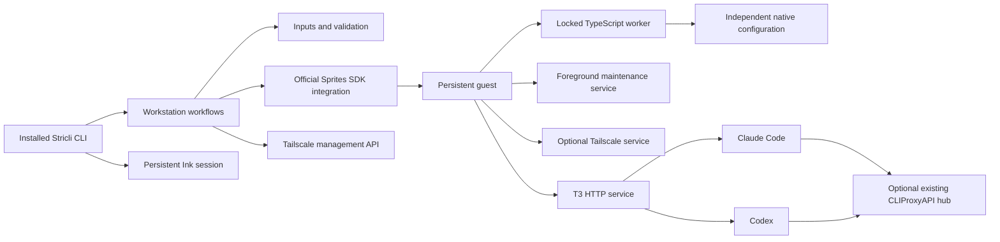

# Workstation architecture

agent-sprite is a Node 24+ CLI that creates and manages persistent Fly Sprites through a layered workflow. Root workflows coordinate domain modules and narrow external integrations; an installed guest runs T3 Code, maintenance cron and optional Tailscale. Claude and Codex keep separate native configuration and plugin identities.

## File structure

The tree includes every root source module and the principal nested boundaries; nested leaf listings are selective.

```text
bin
  cli.mjs                     # Installed executable and last-resort output boundary
scripts
  packed-cli.mjs              # Shared build, pack, install and execution runner
src
  command.ts                  # Internal result and interaction contracts
  command                     # Typed command options and concrete result data
  create.ts                   # Private provisioning workflow
  create                      # Preflight, configuration, completion and recovery
  errors.ts                   # Typed error codes, safe causes and exit mapping
  input.ts                    # Input-resolution entry point
  input                       # Credentials, source precedence and optional choices
  inspect.ts                  # Live list/show and current doctor observations
  machine.ts                  # Provider-derived workstation summaries and names
  navigation.ts               # Safe back/cancel navigation contract
  navigation                  # Typed navigation exits
  operation.ts                # Invocation lifetime, cancellation, identity and tracing
  plugins.ts                  # Per-harness plugin selection contract
  readiness.ts                # Observed readiness assessment
  setup.ts                    # Configuration and incomplete-installation recovery
  setup                       # Section selection, shared configuration and failure recovery
  terminate.ts                # Exact-target deletion and separate tailnet cleanup
  validation.ts               # Determinable input and command conflict checks
  workstation.ts              # Validated internal workflow dispatch
  workstation                 # Shared configuration order and safe action-menu requests
  cli                         # Non-JSX Stricli, output and real terminal adapters
    application.ts            # Application metadata and supported help formatting
    commands.ts               # Six command definitions and examples
    execute.ts                # Command-owned mode, cancellation and output lifetime
    flags.ts                  # Command-specific flags and value placeholders
    interaction.ts            # One Ink root and queued prompts
    output.ts                 # Prepared stream output, readable results and TSV
    reporting.ts              # Real stage/status reporting and quiet filtering
    activity.ts               # Persistent-root active-stage state
    serialization.ts          # Versioned, structurally safe final JSON
  components                  # All React/Ink views, prompts and presentation bridges
  integrations                # External APIs, credentials and guest/native boundaries
    sprites.ts                # Official SDK mapping, pagination and ownership checks
    tailscale.ts              # Enrollment, route approval and managed node cleanup
    credentials.ts            # Local native secure storage and protected-file fallback
    guest                     # Guest runtime, services, files and locked transactions
    native                    # Independent Claude/Codex, GitHub/Git and T3 configuration
  scripts                     # TypeScript payloads compiled for guest deployment
    bootstrap-node.sh         # Sole shell file: checksum-verified Node bootstrap
    guest-transaction.ts      # Serialized payload staging and configuration worker
    install-tools.ts          # Managed stable-tool installation
    updater.ts                # Scheduled/explicit update and truthful status recording
    t3-launcher.ts            # Unprivileged T3 service launcher
    tailscale-launcher.ts     # Optional managed daemon launcher
  utilities                   # Non-React guards, processes, input files and redaction
spec
  e2e                         # Unmocked installed CLI, native PTY and guest-worker checks
  fixtures                    # Real stream/terminal and temporary-file helpers
  mocks                       # Unit-only official Sprites SDK mock
  cli                         # Source-mirrored CLI unit specs
  components                  # Real Ink component unit specs
  integrations                # Source-mirrored native/provider unit specs
```

## Main components

- **CLI entry point** (`bin/cli.mjs`, `src/cli/application.ts`): loads the installed compiled Stricli application. The package exposes only its executable; internal workflow functions are not a public SDK.
- **Execution boundary** (`src/cli/execute.ts`, `src/operation.ts`): resolves interaction before effects, owns cancellation and retains observed resource identity for recovery. One invocation-scoped context prevents work from starting after its owner closes.
- **Interactive session** (`src/cli/interaction.ts`, `src/components/InteractionRoot.tsx`): keeps one Ink root mounted across a prompt queue. Rendered components collect input and display state; workflows own cloud mutations.
- **Inputs and validation** (`src/input.ts`, `src/validation.ts`): apply explicit-source precedence, resolve eligible fallback credentials lazily and aggregate determinable preflight issues before provisioning.
- **Workstation workflows** (`src/create.ts`, `src/setup.ts`, `src/workstation/configuration.ts`): share ordered native configuration steps, preserve unrelated settings and retain failed resources for recovery.
- **Provider integration** (`src/integrations/sprites.ts`): authenticates, paginates live records and checks management/organization identity. Termination revalidates the immutable target identity immediately before deletion.
- **Guest transactions** (`src/integrations/guest/transaction.ts`, `src/scripts/guest-transaction.ts`): serialize configuration, payload and manifest operations under one guest installation/update lock. Updater writes reread current state and merge only updater-owned fields.
- **Native integrations** (`src/integrations/native/claude.ts`, `src/integrations/native/codex.ts`): merge real JSON/TOML and apply independently selected native sources/plugins. Shared reconciliation keeps harness differences explicit.
- **Runtime inspection** (`src/integrations/guest/runtime.ts`): checks services, routing, native configuration and T3 provider discovery without a paid model turn. Probe failures become findings rather than disappearing or aborting unrelated observations.
- **Maintenance** (`src/scripts/updater.ts`): installs managed stable tools when due, restarts registered selected services and records success only after the required work succeeds.

## Dependency and execution flow



1. Validate known input/mode conflicts, resolve selected credentials and preflight provider/tailnet facts before provisioning.
2. Provision privately, acquire the guest lock and bootstrap checksum-verified Node when needed. Fixed inline shell glue holds the lock while the compiled worker starts; the TypeScript worker stages the remaining payloads and processes requests.
3. Install managed developer tools, join the selected tailnet before accessing a private proxy, then merge native settings and plugins.
4. Start services and assess current route, DNS, proxy and actual T3 provider/plugin evidence.
5. Make T3 public after readiness succeeds. Mint a native code last only for an explicit pairing request.
6. Ordinary list/show read the control plane. Explicit inspection and doctor execute guest checks and may wake the workstation.

External integrations may depend on owning leaf contracts and permitted helpers, but cannot import application workflows or CLI implementations. Guest scripts form a separately deployable boundary: only permitted built-ins, `ws` and sibling scripts may be imported. Components never own cloud effects. These import directions are reviewed as architectural constraints; the project registers no custom ESLint boundary rule. Package subpath imports resolve module locations and do not enforce dependency direction.

## Packaging and local execution

Source `imports` resolve `#*` to `src` and `#components/*` to TSX. `publishConfig.imports` resolves the same aliases exclusively to compiled `lib` output when pnpm packs the package. Consequently, invoking the checkout bin against compiled files is not supported.

`scripts/packed-cli.mjs` is the common runner for local use and packaged end-to-end checks. It builds, packs and installs a temporary tarball, then runs the installed bin with the caller's arguments, environment, working directory, signals and exit status. The manifest stays private and no release workflow is supplied.

Guest TypeScript is compiled into `lib/scripts`. The explicit postbuild asset step adds only `bootstrap-node.sh`; deployment reads compiled payloads from the installed package. No broad source-directory copy or source-checkout dependency is required.

## State, ownership and recovery

Provider labels identify management/schema and completed versus incomplete setup. Name, immutable ID, organization, creation time and provider URL come from live provider records. No local workstation registry replaces that state.

Detailed non-secret installation state lives in `/opt/agent-sprite/manifest.json`: versions, enabled integrations, maintenance time and managed tailnet identity. Separate private ownership records retain native proxy fields for safe restoration. Disablement restores only unchanged manager-owned values, preserving user edits and unrelated settings.

Full setup can recover an incomplete installation. Node availability alone does not mean installation completed. A targeted section repair does not assert global readiness or silently clear an incomplete label. During create, a final pairing failure after readiness/exposure succeeded preserves the ready workstation; an earlier failure attempts private visibility and reports the actual restoration/label outcome. Setup failures retain their section and incomplete-label outcome. Full setup marks READY only after its requested pairing step succeeds.

Termination captures the exact managed tailnet identity before Sprite deletion and reports node cleanup independently. A failed or ambiguous query is never absence proof. Destructive consent belongs to the exact request: navigating from show to terminate clears inherited consent and requires its own target confirmation.

## Privilege and credentials

Root installation operations use trusted managed paths. Agent-owned tools and native probes execute through the unprivileged account; recursive ownership/configuration work refuses symlinks instead of following them into unrelated paths. Guest mutations share the transaction lock, including native and manifest writes.

Sprites and Tailscale management tokens remain local. Enrollment uses a transient private file that is removed after use. Selected GitHub and proxy client credentials intentionally persist in protected native guest configuration. Native GitHub authentication configures separate `agent` and provider-shell `sprite` accounts.

Optional credentials are resolved lazily, so an explicit usable source does not fail because an unused saved store is malformed. Storage outcomes report the actual native or protected-file backend. Original work errors retain bounded redacted causes and independently reported restoration/storage failures.

No Sprites connector feature exists. CLIProxyAPI is an existing optional hub: enabled Claude and Codex routing uses their supported native interfaces; disabled routing leaves native sign-in/configuration. The manager generates no static model menu or additional hub.

## Cancellation and output

The CLI owns one physical-interrupt authority. First interruption requests cooperative cancellation and bounded recovery; a second forces exit 130. Unsupported SDK operations may continue remotely after local cancellation, so results preserve known target identity and do not claim rollback or remote cessation.

Human successes use stdout, human failures/cancellations use stderr, and JSON emits one versioned final stdout object. Progress and verbose diagnostics use stderr. Structural pairing capability permits disclosure only after an explicit mint request; the shared registry redacts other resolved secrets at every output boundary. Piped lists use escaped headerless TSV rather than a terminal table.

## Services, maintenance and activity

T3 exposes port 3773 through the provider URL and is the sole public HTTP service. Administration uses authenticated provider exec/filesystem/service interfaces. T3 runs as `agent` and depends on `tailscaled` only when enabled. Foreground `agent-sprite-cron` runs as a separate Sprite service.

Cron checks every 30 minutes while the Sprite runs. Once seven days have elapsed since the last successful update, the updater acquires the shared nonblocking lock and a bounded activity hold, installs latest stable managed tools, restarts required registered T3/Tailscale services in dependency order and captures versions. Idle cron acquires no hold. Success time advances only after required work succeeds; failed work remains due.

Services definitively absent from a validated registry are skipped during restart; malformed or failed provider responses are not treated as absence. There are no compatibility, staging, active-work or pinned-Node-major gates. Updates can interrupt active work. Project dependencies, the guest distribution and Sprites runtime are outside maintenance scope.

Native Claude/Codex work hooks and managed setup/update operations provide bounded activity holds. Arbitrary tools, shell activity and paths bypassing hooks remain outside that coverage.

## Verification boundaries

Unit specs mirror source paths and may mock only `@fly/sprites`. Native file merging, parsers, processes, streams and ordinary Ink components use real implementations. The dedicated end-to-end project exercises the installed package, including real native PTYs, rather than rewriting checkout aliases or simulating a whole workflow.

Focused coverage is an accepted limitation. Configured 100% thresholds remain unchanged; uncovered OS, network and validated-guard paths are reported separately from passing tests. Paid model turns, billing, soak, outage/concurrency experiments, Windows terminals and screen-reader behavior remain outside the verified scope. Operational run narratives belong in work evidence rather than durable documentation.
